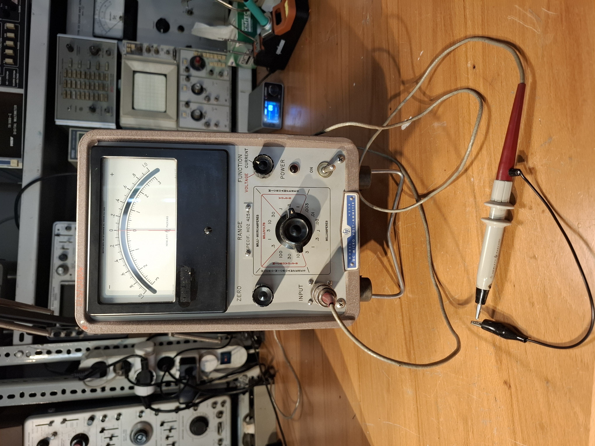
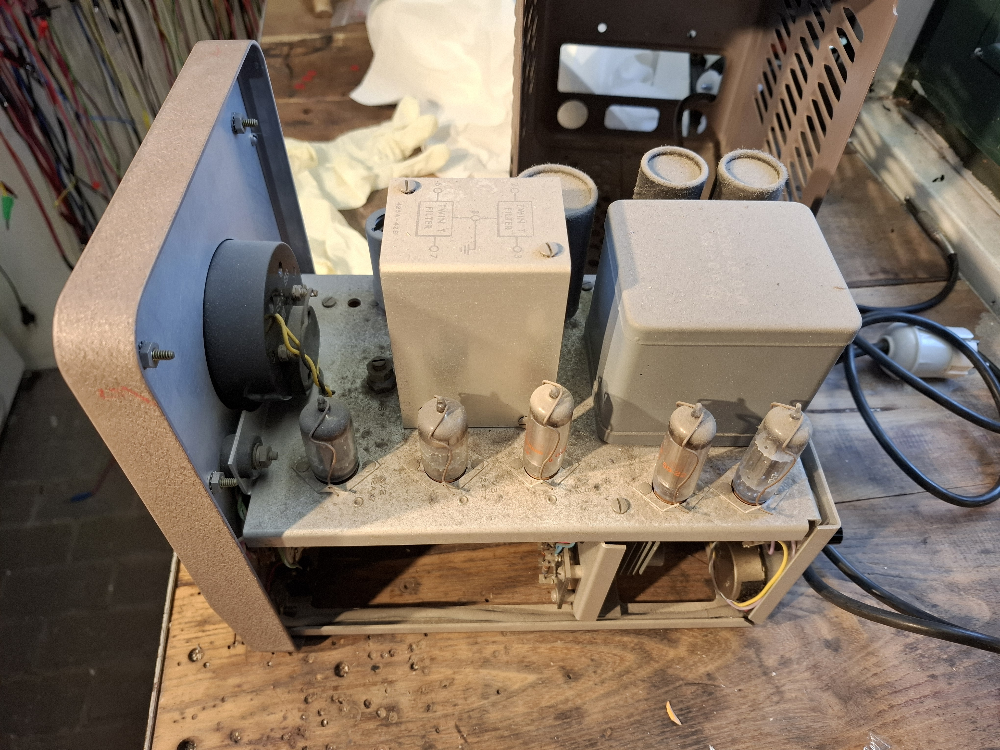
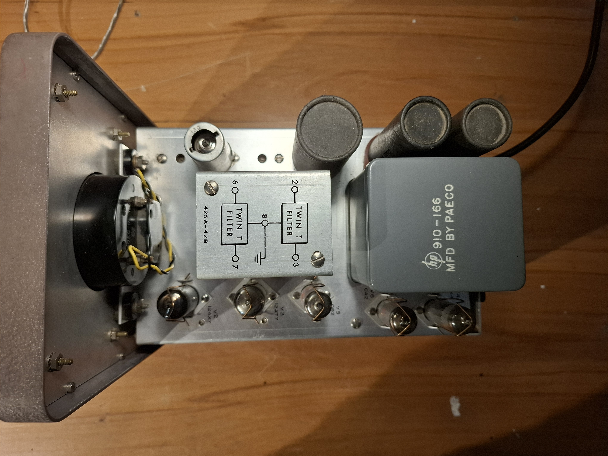
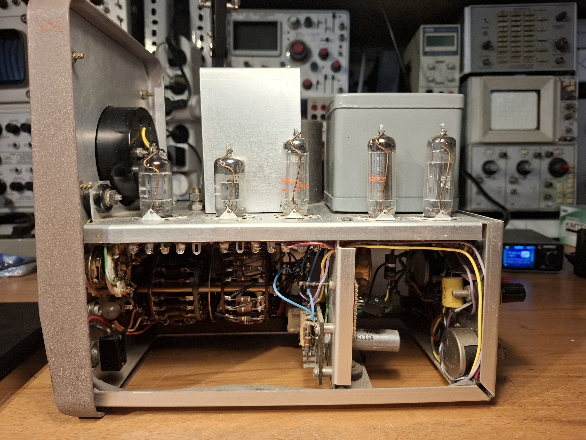
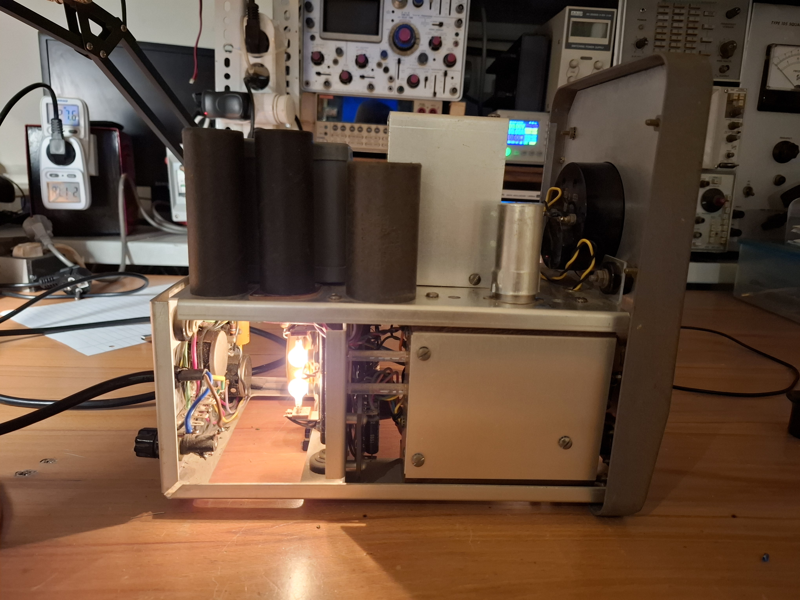
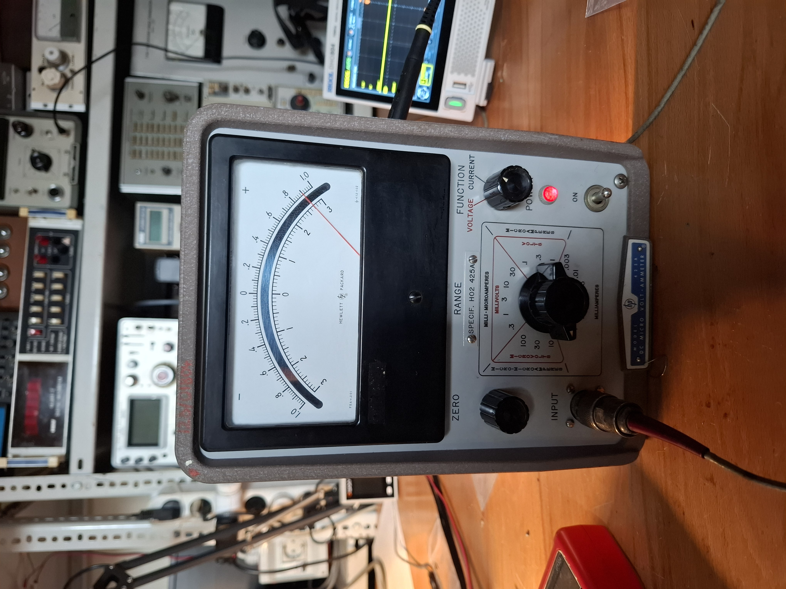

# HP 425A DC micro volt-ammeter
January 2026

## Minor maintenance
The unit was only tested after replacing the original selenium rectifier with a modern silicon rectifier bridge. The mains cable was replaced, and the unit was thoroughly cleaned. The tube sockets were cleaned with contact cleaner.

The instrument uses a chopper amplifier to measure uV and pA through a shunt. The chopper uses a motor to interrupt the path of light from incandescent bulbs through a light guide and to photodetectors. The chopping frequency is chosen to be 4/5 of the line frequency. This frequency is removed from the amplified signal using some filters.

Here the unit is used to measure a 100G resistor, the scale reads ~10pA when 1V is applied. The original, low triboelectric triaxial cable was used.

