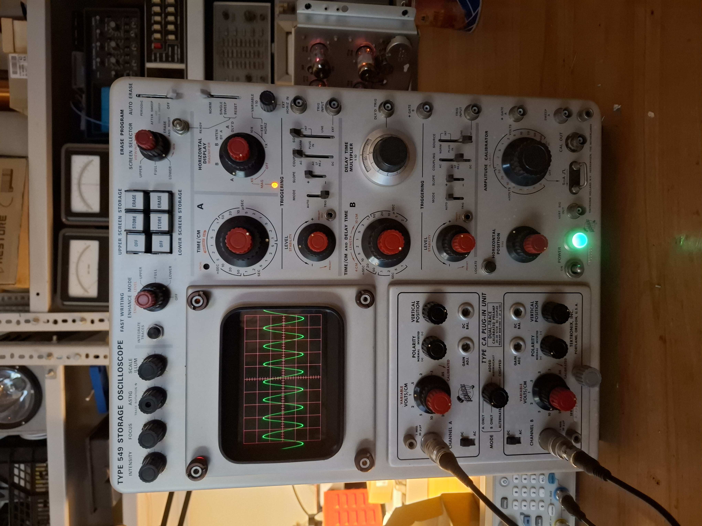
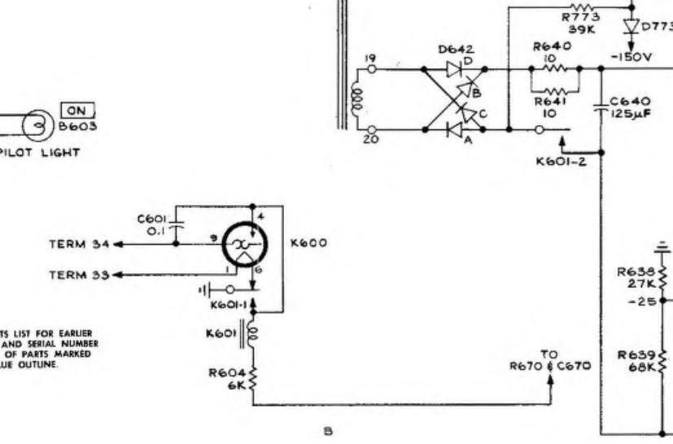
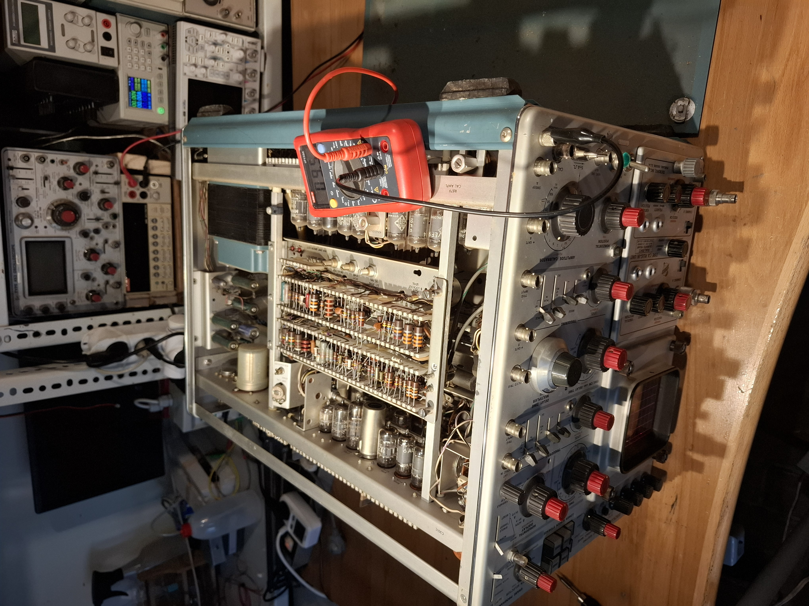
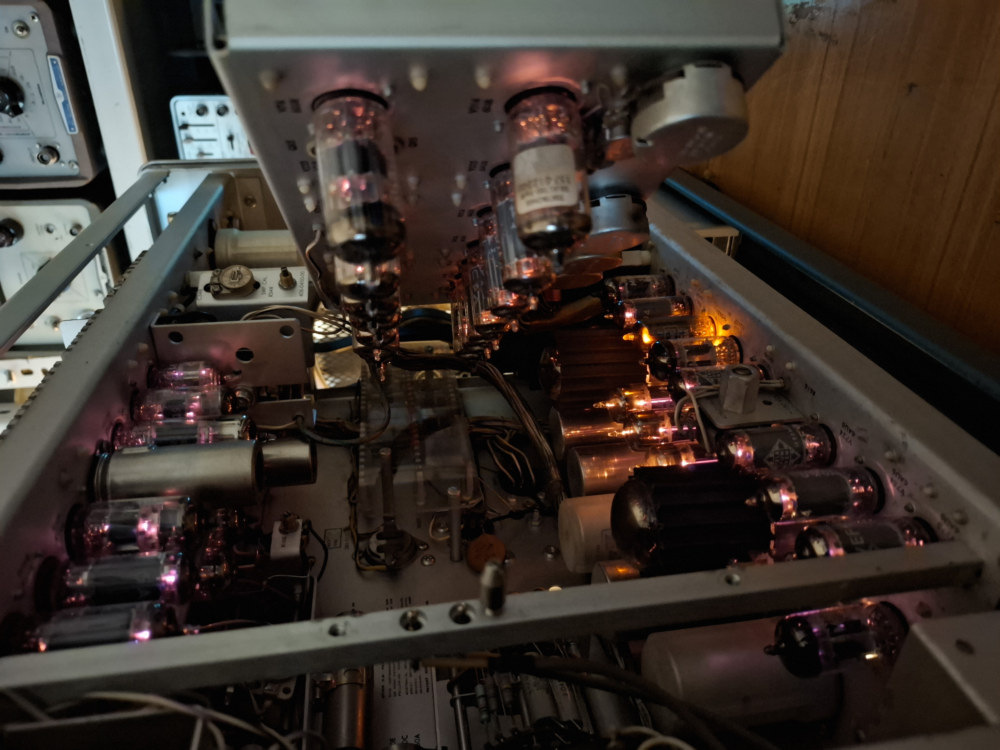
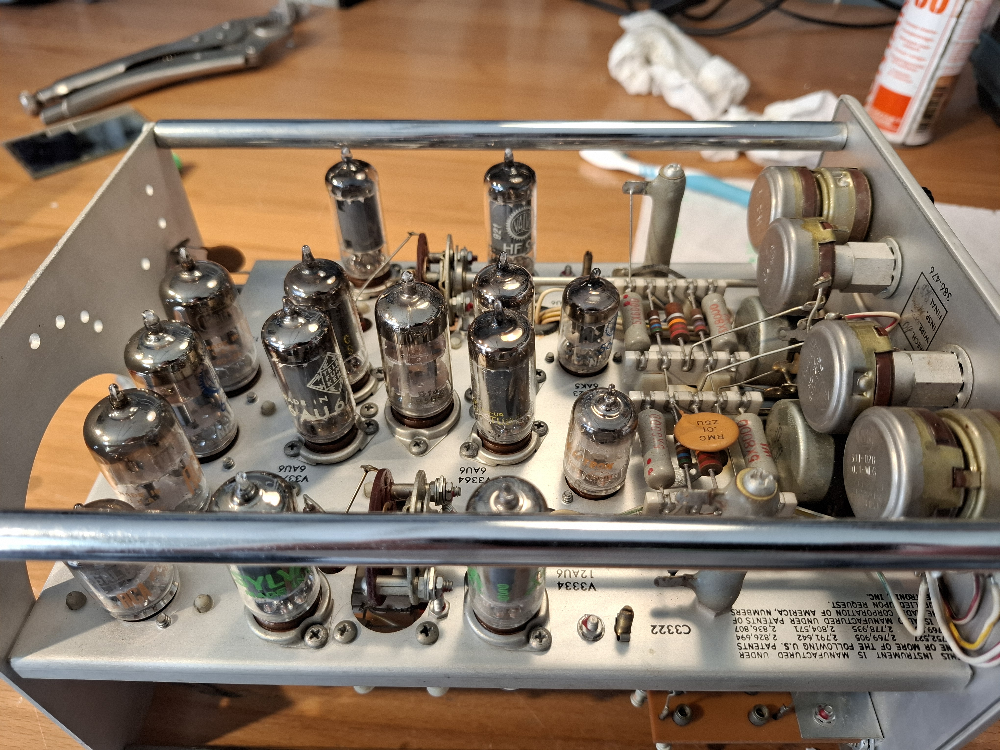
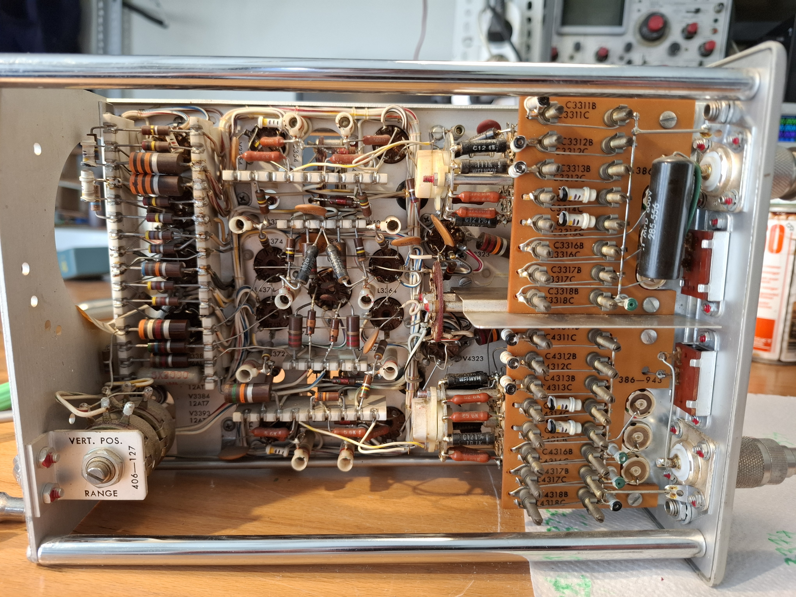

# Tektronix 549 cathode ray oscilloscope repair
May 2026

The Tek 549 was one of the first analog storage oscilloscopes, released in 1965. Inflation adjusted price was about 20kUSD (2026), and it weighed 32kg. It has a bandwidth of 30MHz, a delayed time base, two separately controllable storage zones in the CRT and a voltage calibrator.

## Symptom: no CRT activity, only fan spin and power draw

Because of the large number of vacuum tubes in the scope (~60), heater power is supplied first, and a bimetalic delay tube turns on the power supplies after the tubes have warmed up.

Term 34 and Term 33 are connected to a 6.3V tap on the main transformer. K601 switches power to the plate voltage supplies. On powerup, K601-1 lets power flow to the heater of K600. After about 30s, the bimetal switches, energizing the coil of K601. Then K601-1 removes power from the thermal delay tube, and keeps K601 on.

The thermal delay tube recieved no heater power. This was due to a dirty K601-1 contact. The contact was cleaned, and the delayed turn-on now operates.

## Cleaning

The B sweep is mounted on a fold-out panel above the power supplies.

The unit had a Type CA dual channel vertical plug-in.

