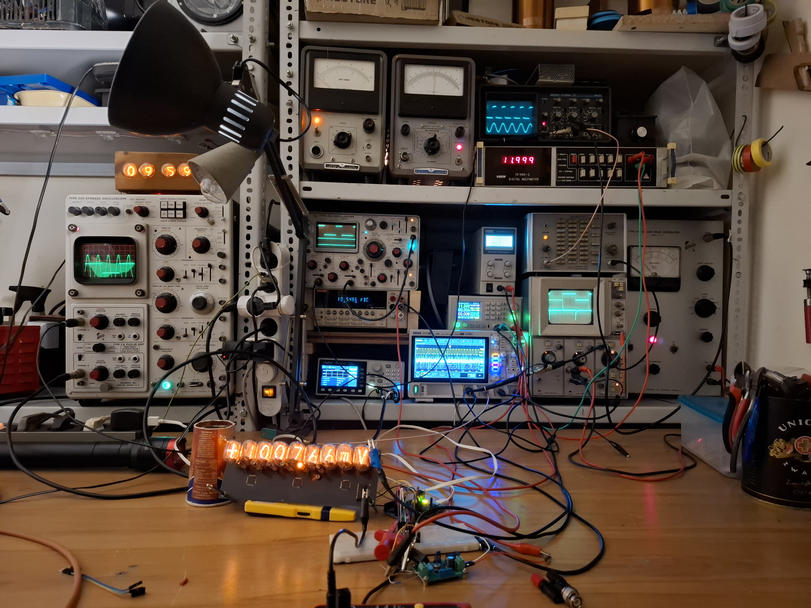

# Electronics Repair & Engineering Portfolio

## Test Equipment Repair & Restoration

* **[Keithley 2000 6.5-Digit DMM Repair](projects/keithley_2000_dmm_repair.md)**
  Extensive restoration involving severe power supply corrosion repair, logic line troubleshooting, and the fabrication of a custom 10-channel scanner card.

* **[Tektronix 549 Cathode Ray Oscilloscope Repair](projects/tektronix_549_repair.md)**
  Diagnostics and repair of a 32kg, 1965 vintage analog storage oscilloscope, including troubleshooting the thermal delay startup sequence.

* **[Philips PM3207 Cathode Ray Oscilloscope Repair](projects/philips_pm3207_oscilloscope_repair.md)**
  Mechanical and component-level repairs to restore missing channels, vertical position controls, and trigger circuitry.

* **[HIKI TR-1660C 4.5-Digit DMM Repair](projects/hiki_tr_1660c_dmm_repair.md)**
  Diagnostics, clock signal restoration, and precision input calibration for a 1980s digital multimeter.

* **[HP 425A DC Micro Volt-Ammeter Restoration](projects/hp_425a_restoration.md)**
  Maintenance and testing of a highly sensitive 1958 chopper amplifier meter capable of measuring picoamps.

* **[HP 428B clip-on DC milliammeter](projects/hp428b.md)**
  Maintenance and calibration of a special clip-on DC milliammeter.

* **[Tektronix 453 Cathode Ray Oscilloscope repair](projects/tek_453.md)**
  Repair of a vertical channel and the delayed timebase.

* **[Macintosh SE FDHD Repair](projects/macintosh_se_fdhd_repair.md)**
  Complete restoration of a vintage Mac, featuring a CRT replacement, analog board repair, logic board recapping, and modern BlueSCSI implementation.

* **[Thinpad T490 backlight repair](projects/T490.md)**
  Replacement of a 0402 SMD fuse by hand.

## Hardware Development & Physics

* **[Franck-Hertz Experiment & Custom Hardware](projects/franck_hertz_experiment.md)**
  Design and assembly of custom laboratory hardware—including independent electrode power supplies, an ultra-low noise transimpedance amplifier, and a PID thermostat—to facilitate a classic quantum mechanics experiment.

* **[Nixie-tube 5.5 digit DMM](projects/nixie_dmm.md)**
  Design of a modern 5.5 digit multimeter with nixie tube display.

* **[Quantum electronics sample holder](projects/sideprobe.md)**
  PCB design of a sample holder for the BME Nanoelectronics Research Group

* **[OpenGamma gamma spectrometer](projects/gamma_spectrometer.md)**
  A gamma spectrometer based on the design of **NuclearPhoenixx**

* **[2013 Imac to monitor conversion](projects/imac_2013.md)**
  A faulty Imac was converted into a monitor, using the original power supply and speakers.

* **[2010 Imac to monitor conversion](projects/imac_2010.md)**
  A faulty Imac was converted into a monitor, with some custom circuitry to reuse the original inverter.

* **[Laboratory classes at BME](projects/lab_classes.md)**
  A total of 21 credits of laboratory classes so far, all passed with excellent marks.

* **[Solid-state Tesla Coil](projects/sstc.md)**
  IGBT H-bridge Tesla coil.

---
