# Franck-Hertz experiment

The Franck-Hertz experiment was conducted in 1914 by James Franck and Gustav Hertz. It involved of accelerating electrons in mercury vapour and measuring the current as a function of acceleration voltage. It was found that when the kinetic energy of the electrons was some integer multiple of approximately 4.9eV, the current suddenly decreased before increasing again for higher energies. This was consistent with the Bohr model (proposed in 1913): When the kinetic energy of electrons equals the energy difference between two states of the mercury atom, it will collide inelasticly, excite the atom and loose its energy. If the electron's energy is not equal to a state transition energy, it will collide elasticly.

The experiment had great influence of the development of early quantum mechanics.

## Details of the experiment

### The tube

The Franck-Hertz tube used was made by Leibold Didactic. It features a clyindrical construction: the heated cathode is surrounded by the g1 grid, the g2 grid and the anode. A small (0-5V) voltage between the cathode and g1 helps thermionic emission, the main collision space is between g1 and g2, where the electrons are accelerated by up to 30eV. A small (0-3V) countervoltage is applied between g2 and the anode to filter those electrons which have excited mercury atoms and have small kinetic energies. This improves the contrast between peaks and valleys in the current graph.

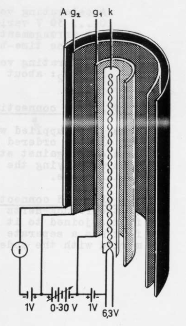

### Heating

The tube contains a drop of liquid mercury. The vapour pressure within the tube can be controlled by heating it, usually between 150-200°C. A furnace with a bore is used for this purpose. Since the vapour pressure of mercury depends very strongly on temperature in this regime, precise control of the tube temperature is required.

### Current readout

The currents are usually between 100pA-10nA. Amplifying such small currents needs special care.

### Electrode supplies

The three variable dc voltages (between cathode and g1, g1 and g2, g2 and anode) need to be varied independently for precise experiments. This was initially achieved by using lab bench power supplies.

# Hardware development

## Electrode supplies

The main supply unit houses the 55V dual op-amp (ADA4522-2) that is used to produce the independenty adjustable electrode supply rails. 

The +12V and -36V supplies are produced using linear regulators (7812, 337). The 6.3V heater supply is unregulated, but current limited via R19.
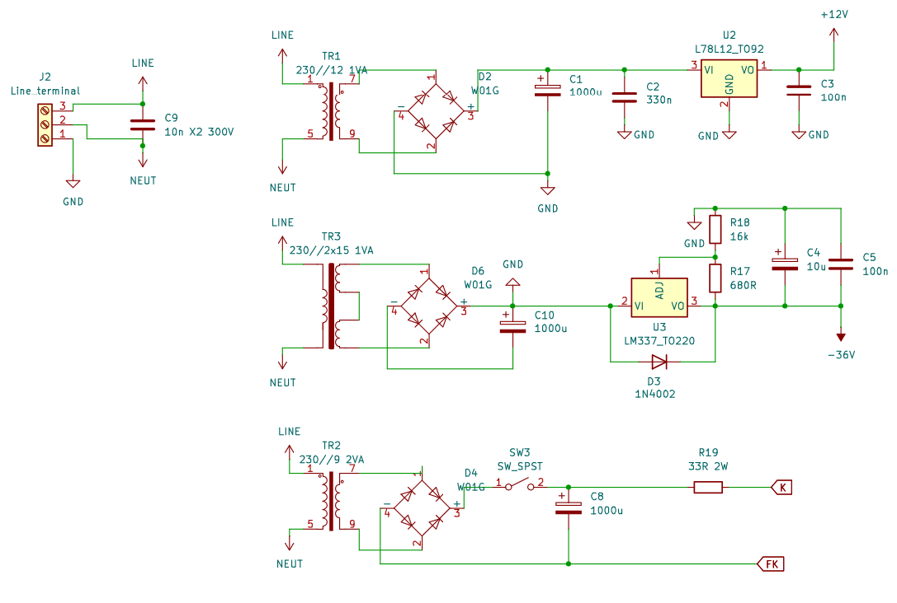

The control inputs for the cathode-g1 and g1-g2 voltages are 0-10VDC, and can be supplied via BNC inputs from the back panel, or from potentiometers on the front panel. The electrode outputs are constructed via an op-amp circuit:

The front panel also has a difference amplifier to measure the accelerating voltage divided by 10, earth referenced. Otherwise, an earthed oscilloscope could not measure this value directly. 

Schematics for the [motherboard](../images/FH_driver_mobo.pdf), and the [front panel](../images/FH_driver_frontpanel.pdf).

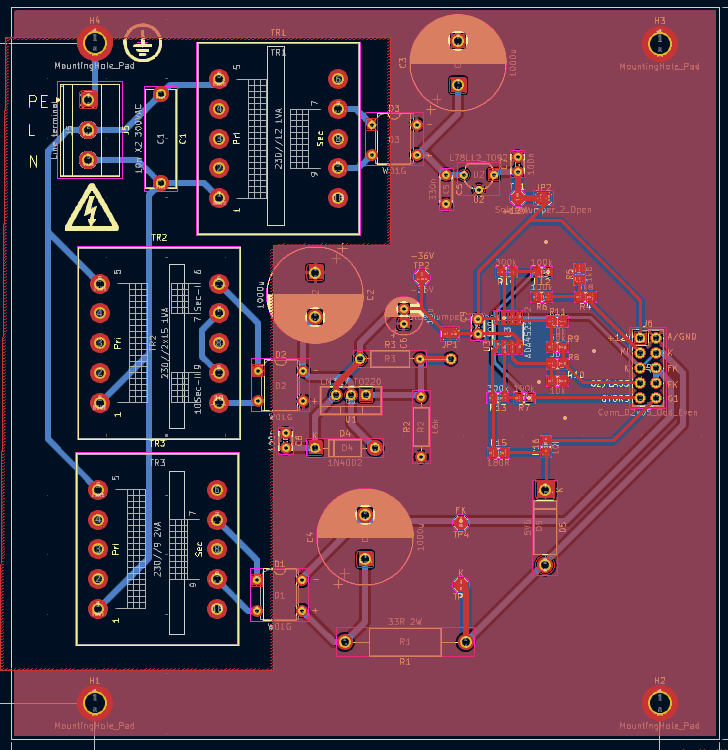
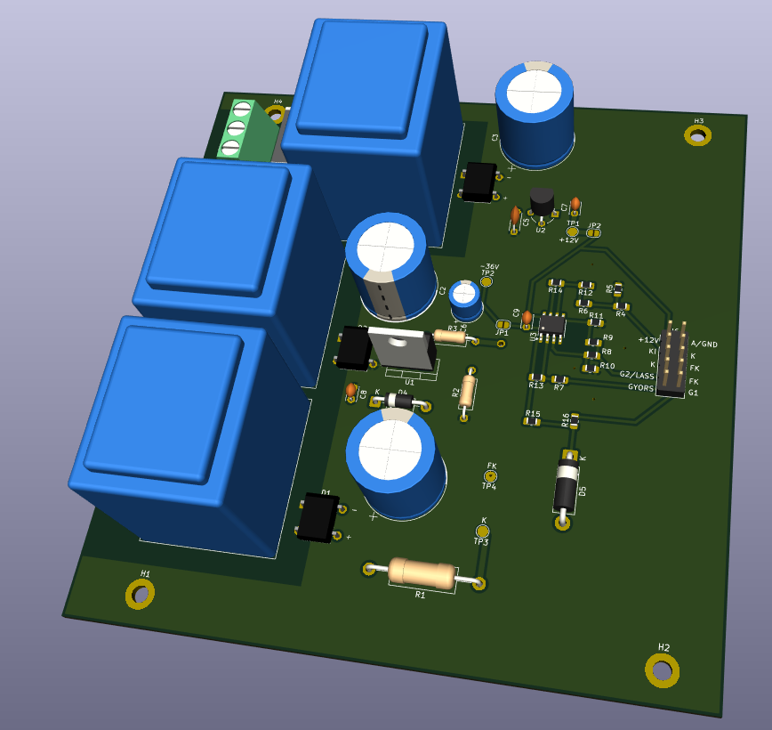

The motherboard is a double layer PCB with THT and SMD construction. A ribbon cable connects to the front panel, where the banana plugs, potentiometers and switches are mounted. The back side has SMD components.

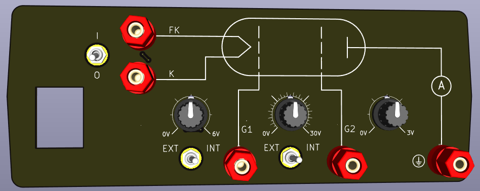

A total of six units were assembled.

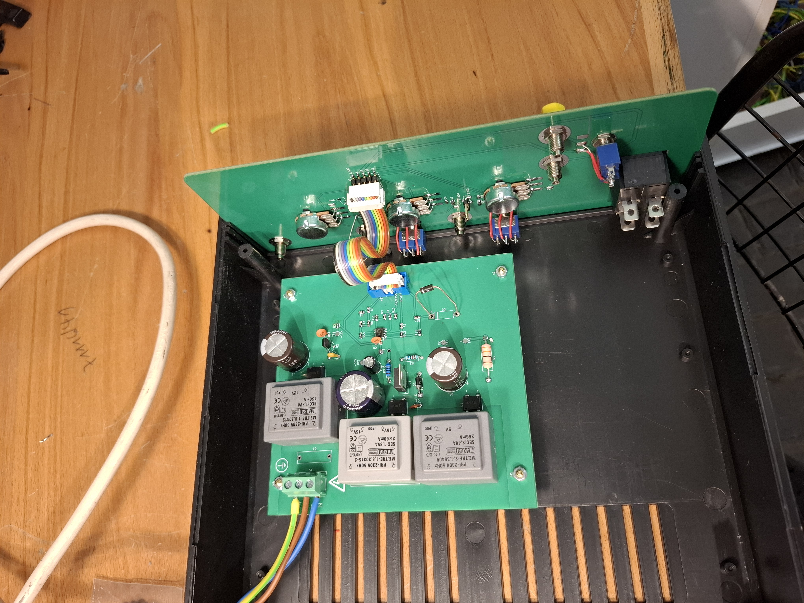
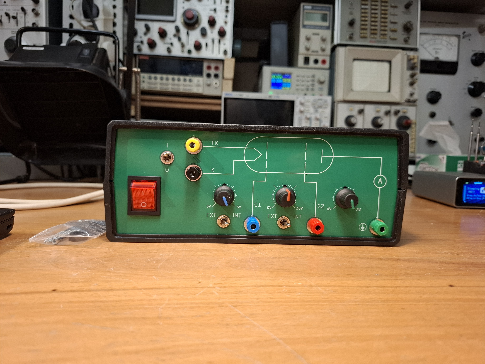
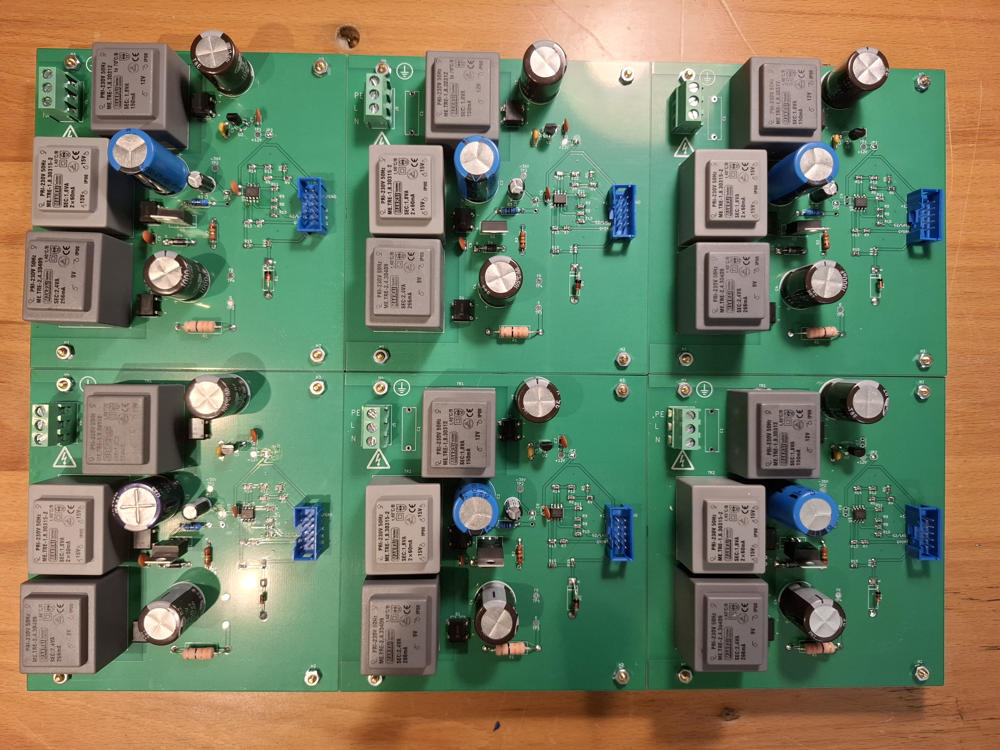

## Transimpedance amplifier

The amplifier amplifies the small currents to voltages that are easy to measure. An ultra low input bias current op-amp (LMC661) was used in an inverting transimpedance amplifier along with a 100M feedback resistor. The output can be low pass filtered and amplified 10x on demand. The PCB was mounted in an aluminium enclosure for shielding, and a schematic diagram was laser engraved on the box. An overload LED indicates when the output is close to the power rails.

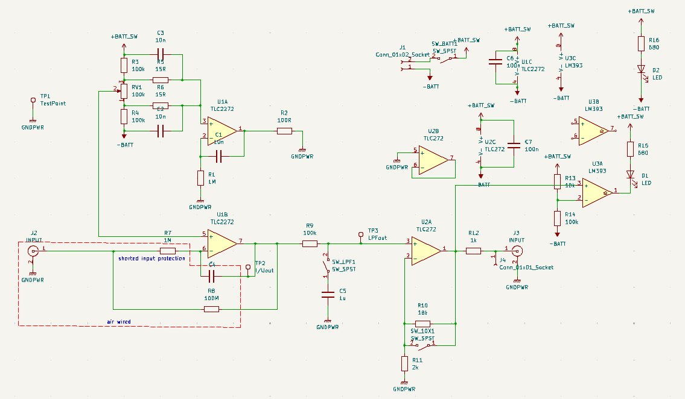
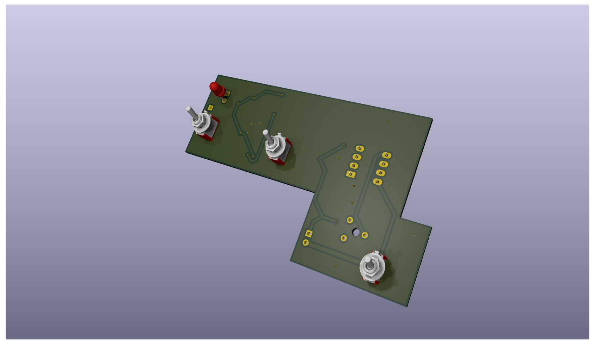
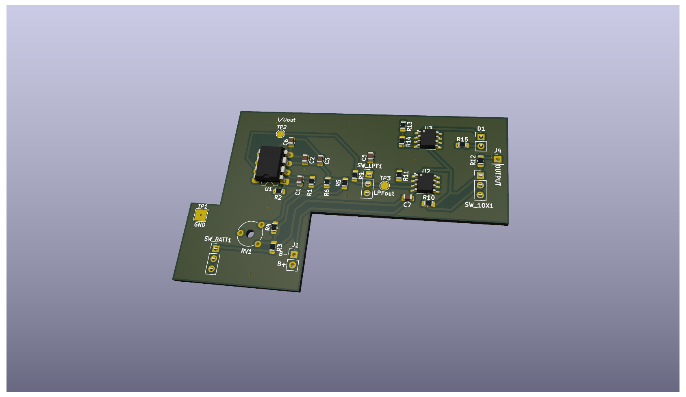

## Thermostat

The thermostat uses a REX C100 PID temperature controller to control the oven via a solid state relay. Neon indicators are used as output and alarm indicators. The thermocouple is glued into the oven, and connected to the thermostat via a jack connector.