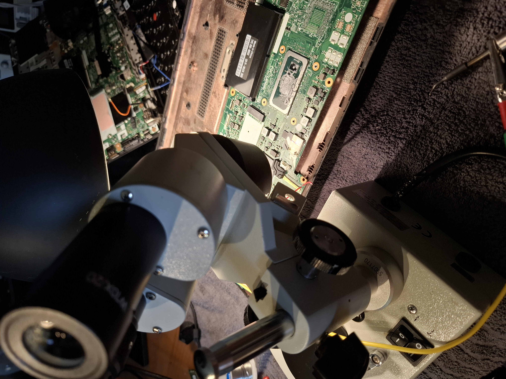
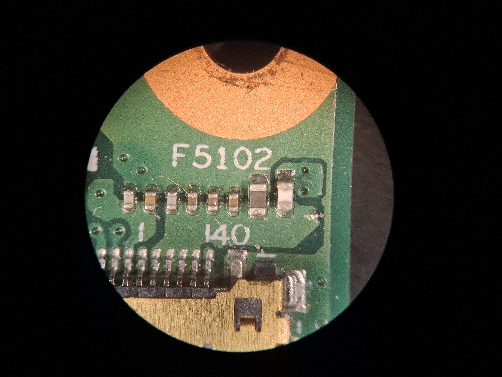
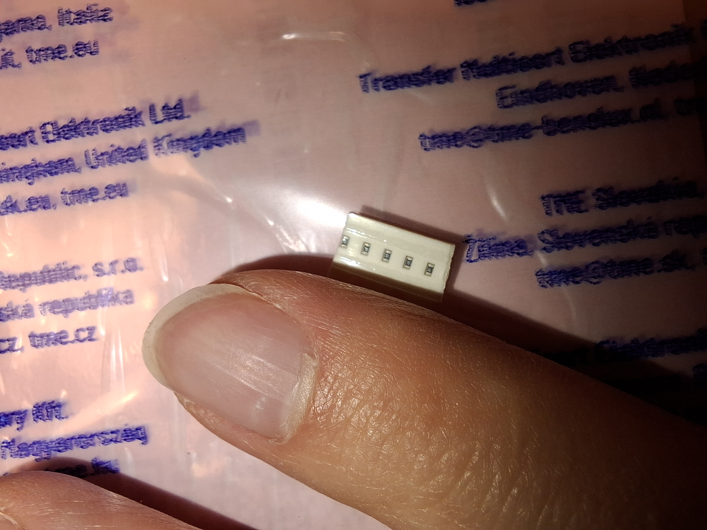

# Thinkpad T490 backlight repair
August 2025

A Thinkpad T490 with a broken backlight was repaired. The display connector had no 20V power. The issue was traced to a 3A fuse.

The 0402 SMD fuse was replaced by hand.

