# Franck-Hertz Experiment and Hardware Development

The Franck-Hertz experiment was conducted in 1914 by James Franck and Gustav Hertz. It involved accelerating electrons through mercury vapor and measuring the resulting current as a function of the acceleration voltage. It was observed that when the kinetic energy of the electrons reached an integer multiple of approximately $4.9 \text{ eV}$, the current suddenly decreased before increasing again at higher energies. 

This behavior was consistent with the Bohr model (proposed in 1913): when the kinetic energy of an electron exactly matches the energy difference between two states of a mercury atom, it collides inelastically, exciting the atom and losing its energy. If the electron's energy does not match a state transition energy, it collides elastically. This experiment had a profound influence on the development of early quantum mechanics.

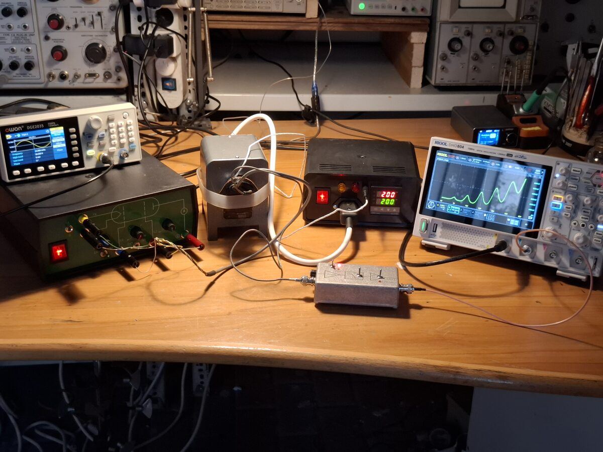

## Experiment Details

### The Tube
The Franck-Hertz tube used in this setup was manufactured by Leybold Didactic. It features a cylindrical construction: a heated cathode is surrounded by a first grid ($g_1$), a second grid ($g_2$), and finally the anode. 

*   A small voltage ($0-5 \text{ V}$) applied between the cathode and $g_1$ assists with thermionic emission. 
*   The main collision space is located between $g_1$ and $g_2$, where the electrons are accelerated by potentials up to $30 \text{ eV}$. 
*   A small counter-voltage ($0-3 \text{ V}$) is applied between $g_2$ and the anode. This acts as a filter to reject electrons that have excited mercury atoms and subsequently lost most of their kinetic energy, which significantly improves the contrast between the peaks and valleys in the output current graph.

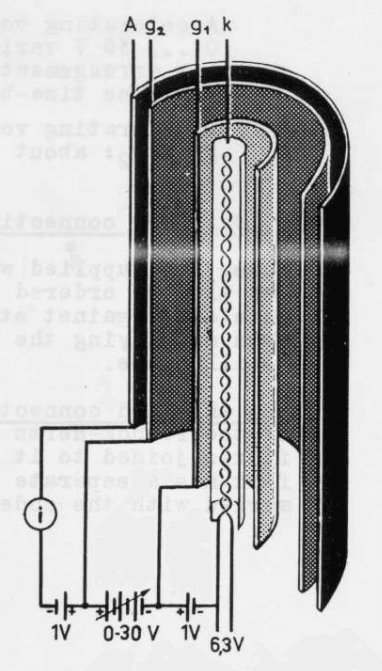

### Heating
The tube contains a drop of liquid mercury. The vapor pressure within the tube is controlled by heating it, usually to a temperature between $150^\circ\text{C}$ and $200^\circ\text{C}$, using a specially designed furnace with a central bore. Because the vapor pressure of mercury is highly sensitive to temperature changes in this regime, precise thermal control of the tube is strictly required.

### Current Readout
The measured output currents are exceedingly small, typically ranging between $100 \text{ pA}$ and $10 \text{ nA}$. Accurately amplifying such minute currents requires specialized, low-noise circuitry.

### Electrode Supplies
For precise experimentation, the three variable DC voltages (cathode to $g_1$, $g_1$ to $g_2$, and $g_2$ to anode) must be adjusted independently. While this was initially achieved using standard laboratory bench power supplies, custom hardware was developed to streamline the process.

---

# Custom Hardware Development

## Electrode Supplies
A dedicated main supply unit was designed to generate the independently adjustable electrode voltages. It utilizes a $55 \text{ V}$ dual operational amplifier (ADA4522-2) to produce these adjustable rails. 

The $+12 \text{ V}$ and $-36 \text{ V}$ base supplies are generated using standard linear regulators (7812 and 337). The $6.3 \text{ V}$ heater supply is unregulated but features current limiting via resistor R19.

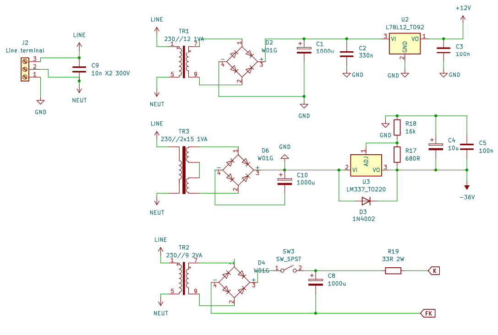

The control inputs for the cathode-$g_1$ and $g_1$-$g_2$ voltages operate on a $0-10 \text{ VDC}$ scale. These can be driven via BNC inputs located on the rear panel, or manually adjusted using potentiometers on the front panel. The final electrode outputs are driven by an op-amp circuit:

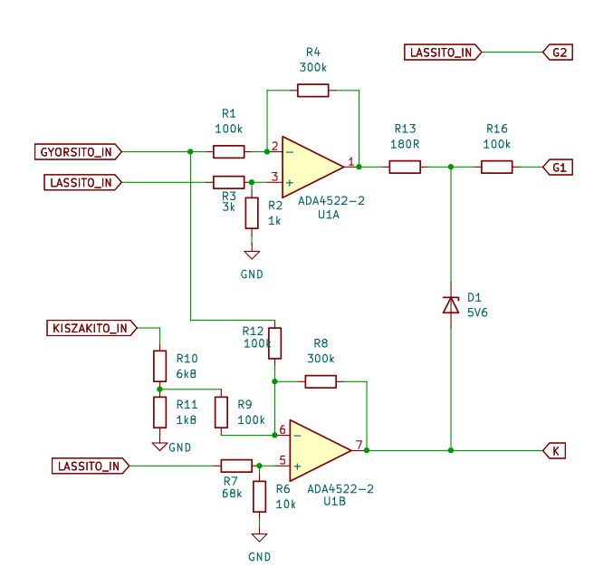

The front panel also incorporates a difference amplifier designed to measure the accelerating voltage (divided by 10) relative to earth ground. Without this earth-referenced signal, a standard grounded oscilloscope would be unable to measure the accelerating voltage directly.

Schematics are available for the [motherboard](../images/FH_driver_mobo.pdf) and the [front panel](../images/FH_driver_frontpanel.pdf).

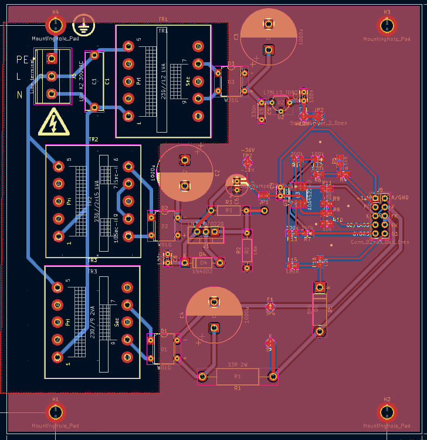
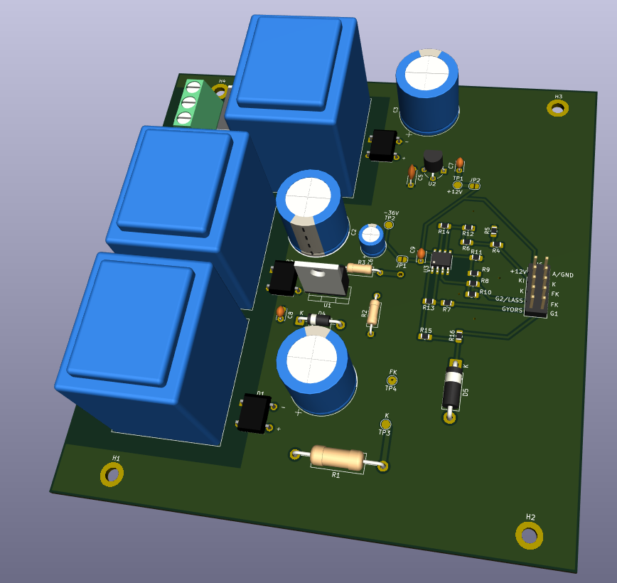

The motherboard utilizes a double-layer PCB featuring a mix of Through-Hole Technology (THT) and Surface Mount Device (SMD) construction. A ribbon cable links the motherboard to the front panel, which houses the banana plugs, potentiometers, and switches. SMD components are populated on the rear side of the board.

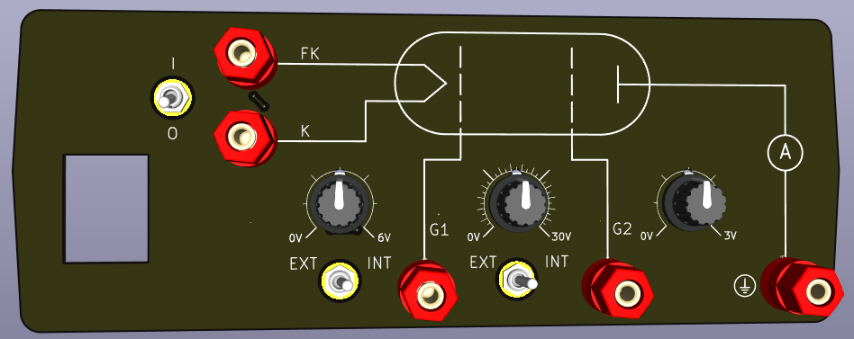

A total of six identical units were assembled for the laboratory.

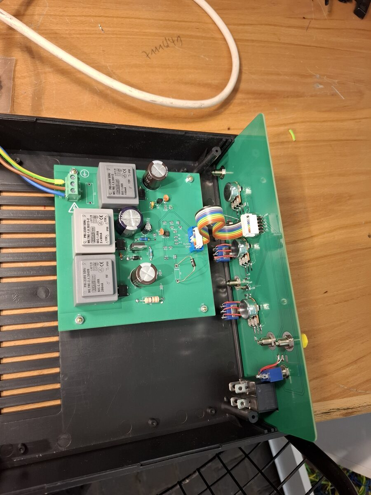
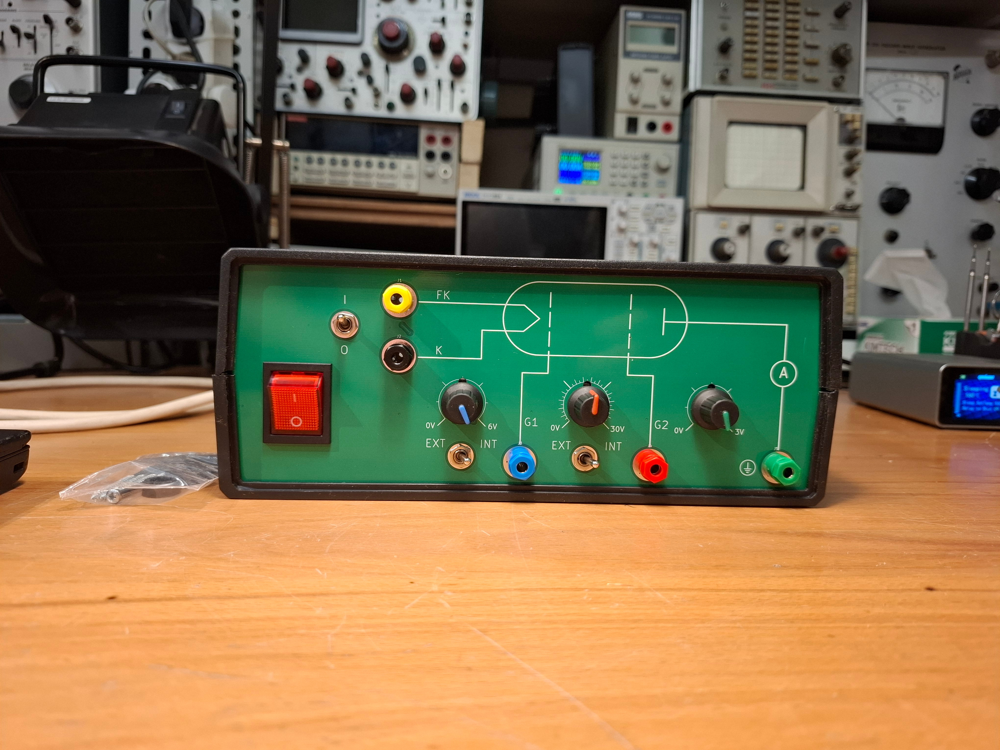
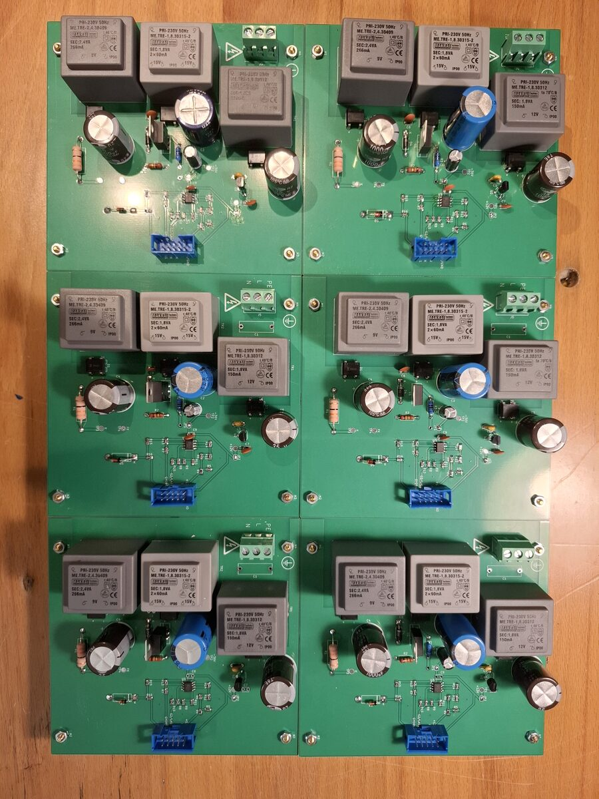

## Transimpedance Amplifier
To convert the extremely small tube currents into easily measurable voltages, a custom amplifier was constructed. This circuit employs an ultra-low input bias current op-amp (LMC661) configured as an inverting transimpedance amplifier, utilizing a $100 \text{ M}\Omega$ feedback resistor. 

The output signal can be optionally low-pass filtered and further amplified by a factor of 10. To minimize external interference, the PCB is housed within a shielded aluminum enclosure. A block diagram of the circuit was laser-engraved directly onto the enclosure for easy reference. An overload LED is included to indicate when the output voltage approaches the power rails.

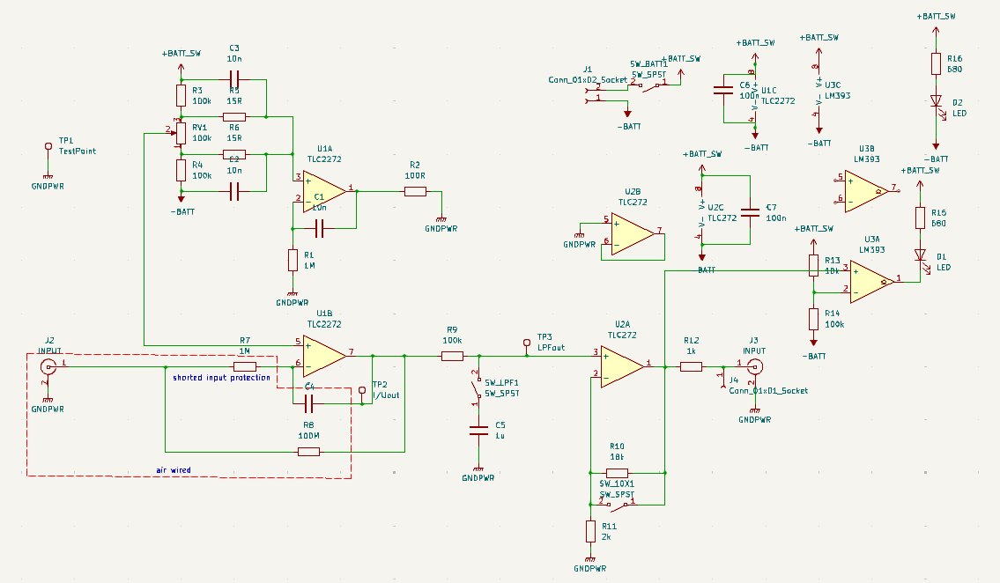
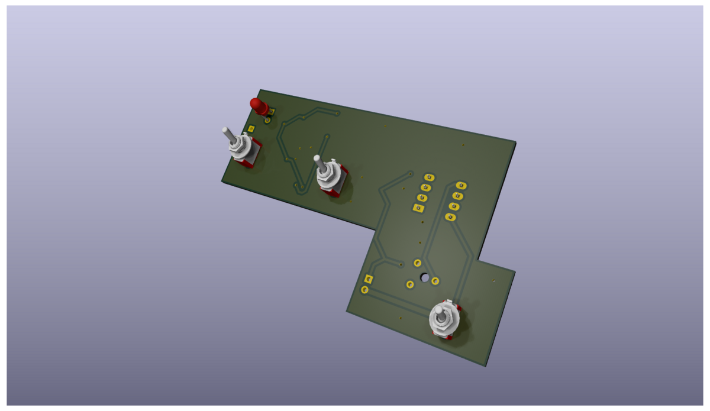
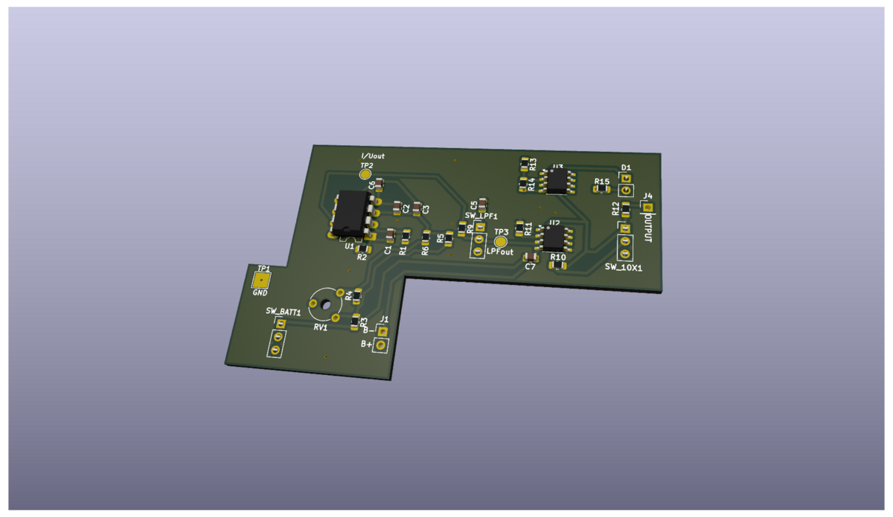

## Thermostat Controller
A custom thermostat was built to maintain the required oven temperature. It utilizes a REX C100 PID temperature controller that switches the oven heating element via a solid-state relay. Neon indicators on the chassis serve as output and alarm status lights. The thermocouple is securely glued into the oven and interfaces with the thermostat unit through a jack connector.