# Open Gamma Detector
June 2025

An open-source gamma spectrometer was built from the [plans of **NuclearPhoenixx**](https://github.com/OpenGammaProject/Open-Gamma-Detector). The spectrometer uses a NaI(Tl) scintillation crystal, a silicon photomultiplier, some amplification and discrimination electronics, and the ADC of a Raspberry Pi Pico2.

The PCB used almost exclusively SMD components. It was housed in an aluminium enclosure for shielding. The crystal and photomultiplier assembly was housed in a machined plastic housing.

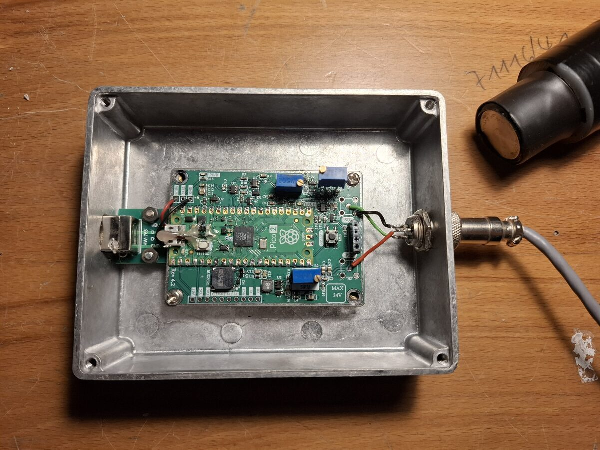

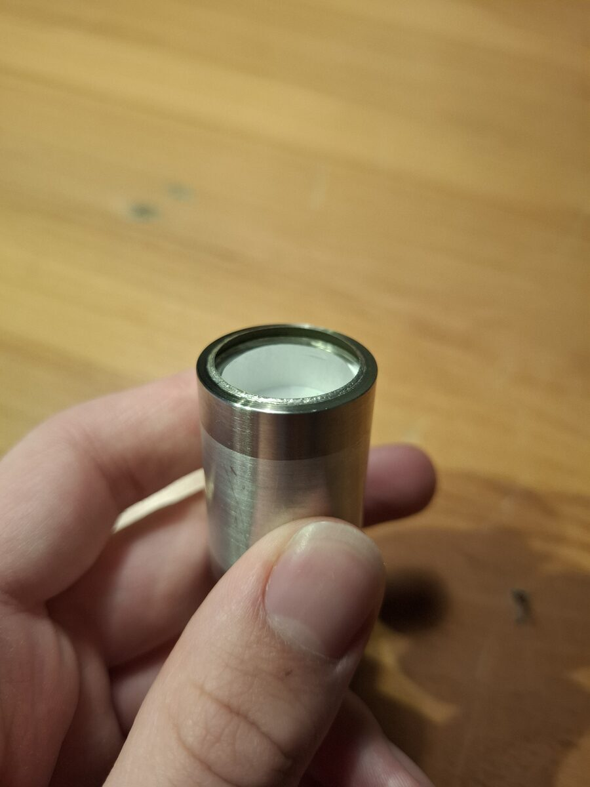

The spectrometer interfaces with a PC via a web app. Gamma spectra were taken using 226Ra, 232Th and 40K sources.

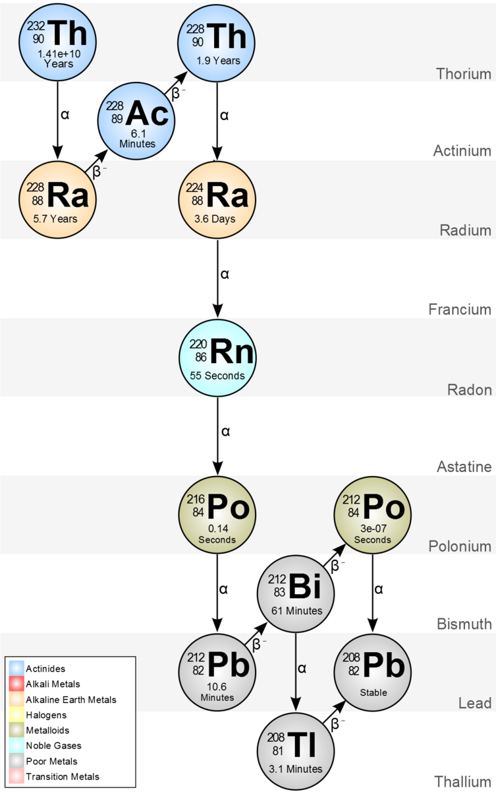

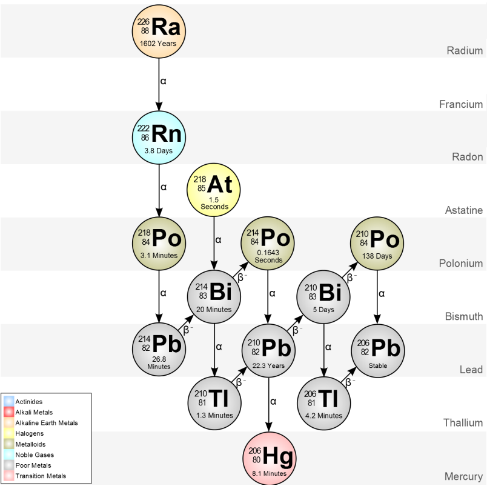

## Calibration

The spectrometer was calibrated using 4 calibration points. The resulting calibration polynomial is quite linear:
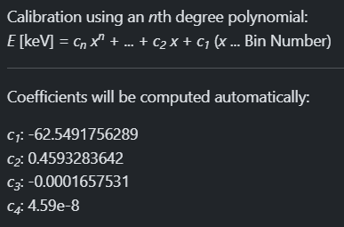

The first point was the 239keV gamma from the 0- to 1- transition of 212Bi, from the beta- decay of 212Pb, in the thorium series.

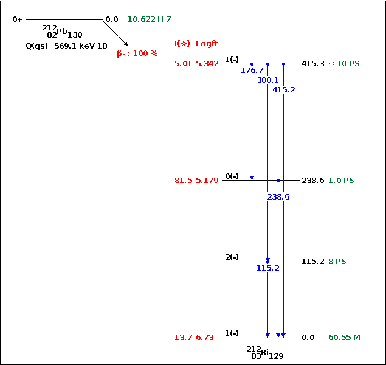

The second point was the 352keV gamma from the 0- to 1- transition of 214Bi, from the beta- decay of 214Pb, in the radium series.

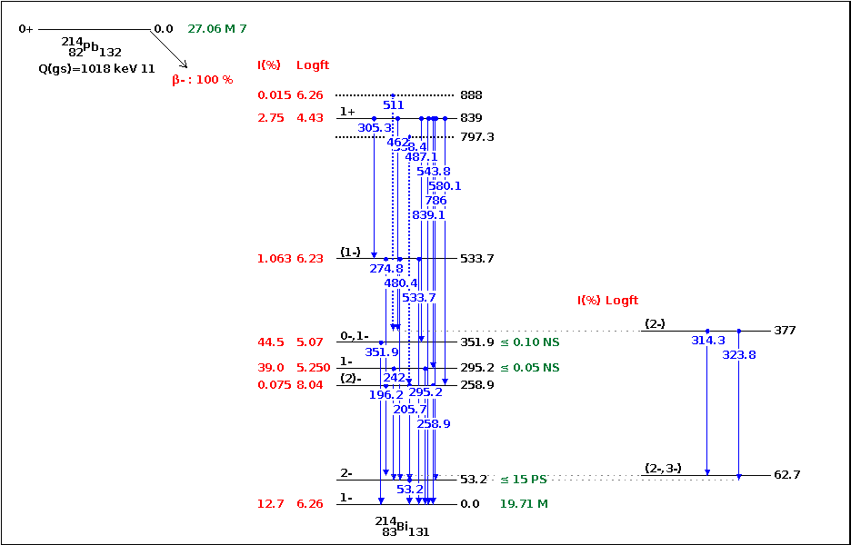

The third point was the 583keV gamma from the 5- to 3- transition of 208Pb, from the beta- decay of 208Tl, in the thorium series.

The fourth point was the 1460keV gamma from the 2+ to 0+ transition of 40Ar, after the beta- decay of 40K.

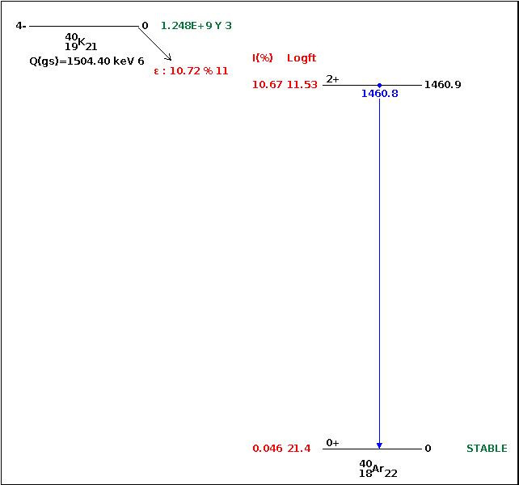

## Spectra

### 226Ra

The radium source was an old radium painted analog dial. It was by far the highest activity soure used, registering over 200cps in the detector. A two hour spectrum was taken, with the two hour background subtracted.

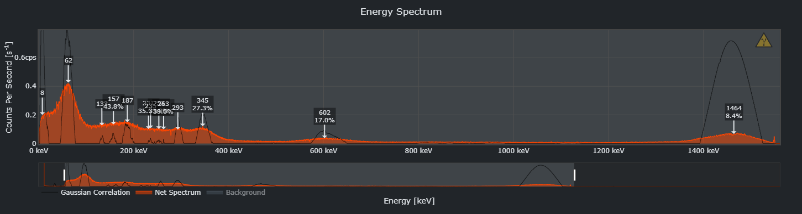

From left to right: the low energy X-ray corresponding to the L transition in Ra (10-18keV) or the L transition of Pb (9-16keV), an aggregate of many different X-rays below 90keV, some backscatter peaks around 130-150keV, the 186keV isomeric transition as 226Ra decays to 222Rn, the 295keV and 351keV ITs as 214Pb decays to 214Bi, the 609keV IT as 214Bi decays into 214Po, and a 1460keV peak corresponding to 40K, of unknown origin.

### 232Th

The thorium source was a set of thoriated welding electrodes. Its activity was much lower, around 60cps.

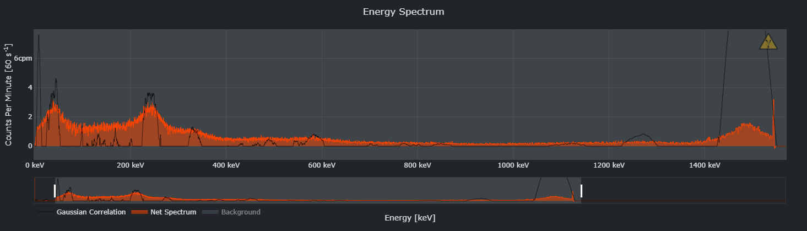

From left to right: low energy X-ray of the Th or Ra L transition (10-19keV), the 40keV gamma from the decay of 212Bi, the 239keV gamma from the decay of 212Pb (calibration base), the 338keV gamma form the decay of 228Ac, the 583keV gamma from the decay of 208Tl, and the same 40K peak.

### 40K

The potassium sample was approximately 1kg of different potassium salts (KI, KHCO3, Na-K-tartarate, etc.). The activity was very low, barely above background. A 2hr spectrum was taken, and a 2hr background was subtracted.

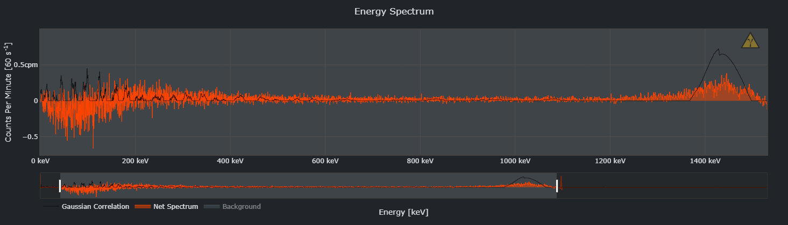

The only clear peak is the 40K peak around 1460keV.