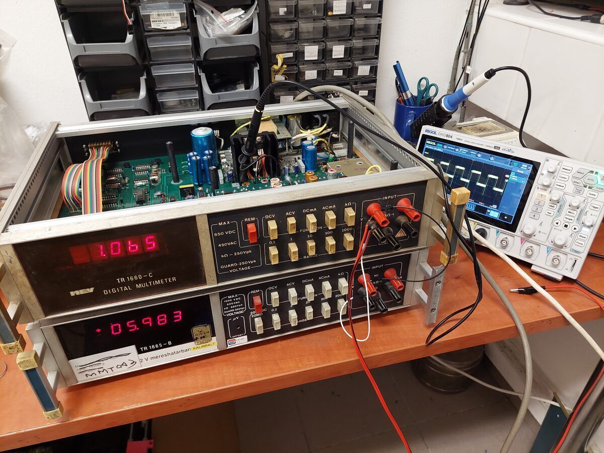
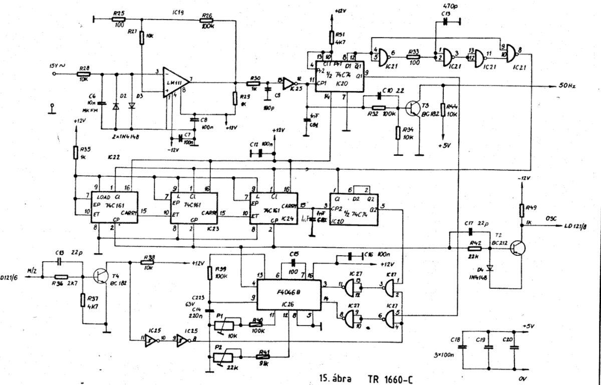
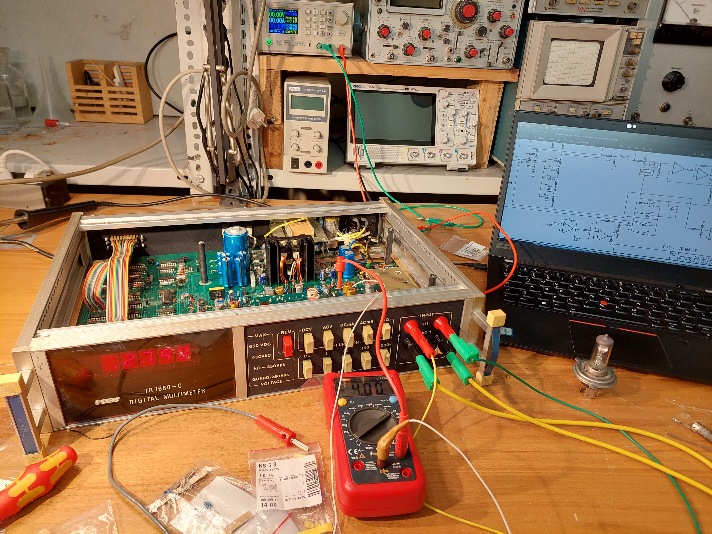

# HIKI TR-1660C 4.5-Digit DMM Repair
**December 2024**

The HIKI 1660C is a 4.5-digit digital multimeter released in the 1980s. It relies on a TI LD120-121 ADC pair, featuring optically and galvanically isolated analog and digital sections. 

**Key Specifications:**
*   Current input with 10nA resolution, alongside AC current measurement capabilities.
*   Support for 4-wire resistance measurement.
*   A DCV range extending up to 1000V, maintaining a 0.1% accuracy.

## Initial Assessment and Preventative Maintenance
The unit initially exhibited no display activity, despite having operational power supply rails. Several electrolytic capacitors were replaced as a preventative measure. Diagnostics showed that no data was being sent from the in-guard LD120 region to the digital LD121 because the LD121 lacked an OSC clock signal.

## OSC Clock Signal Restoration
The A/D clock signal is generated by a Phase-Locked Loop (PLL) that locks its output to the 50Hz mains frequency. While the required 50Hz square wave was correctly generated from a transformer tap, the PLL chip itself (IC26, F4046B) was suspected to be faulty. By temporarily breaking a trace and injecting a 162840Hz square wave directly into the OSC, the display began to show erroneous readings, confirming the diagnosis. The PLL chip was subsequently replaced, restoring the clock signal.

## Input Range Mismatch Correction
During testing, the measured value changed substantially whenever the input range was altered. This issue was traced back to the input attenuation section, where precision resistor R116 (originally 10M 0.1%) had been previously replaced with two 5.1M 10% resistors wired in series. Sourcing and installing a proper precision resistor, followed by a thorough calibration, restored the meter to correct operation.

