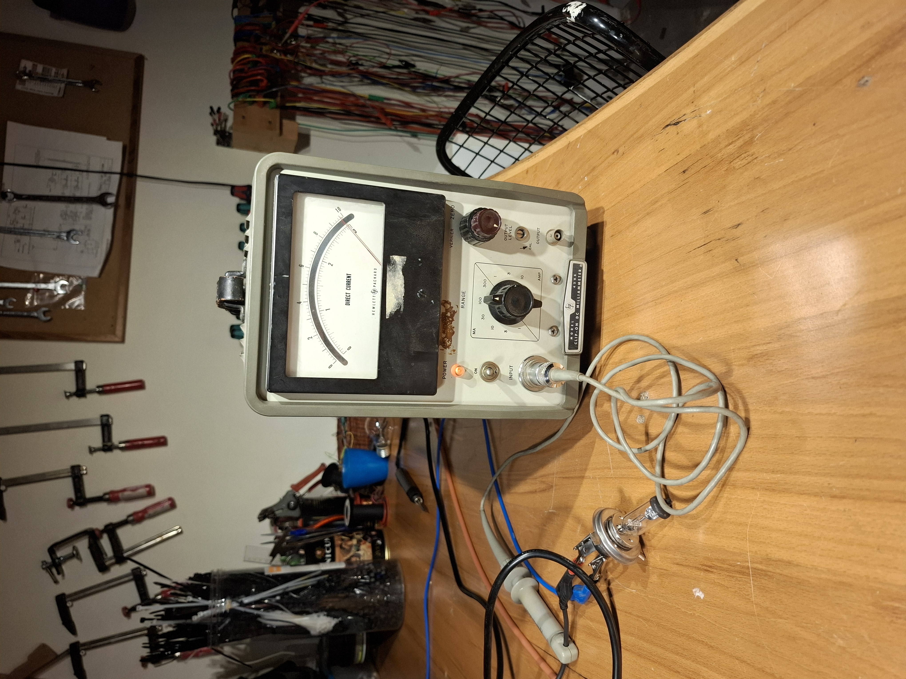
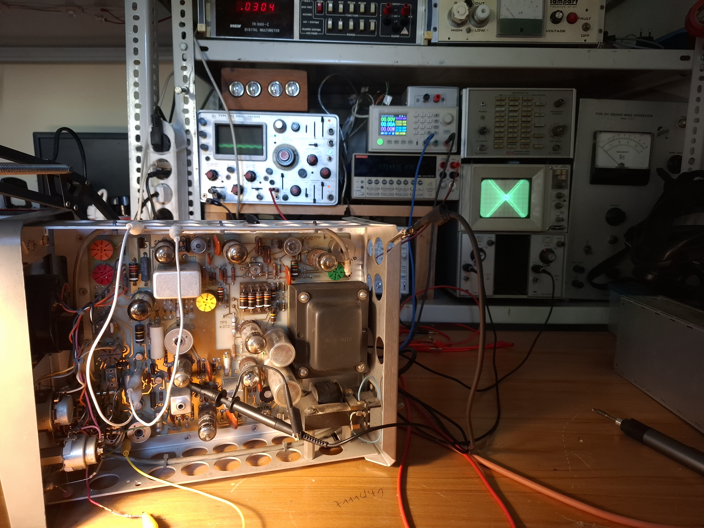

# HP 428B clip-on milliammeter
September 2025

The HP 428B is a DC to 400Hz clip-on milliammeter that measures the magnetic field around a conductor carrying DC or low frequency current. It has 1mA to 10A full scale ranges, and it induces under 15mV into the circuit under test.

The unit was cleaned and calibrated.

<video width="100%" controls>
  <source src="../images/hp428b_calibration.mp4" type="video/mp4">
</video>