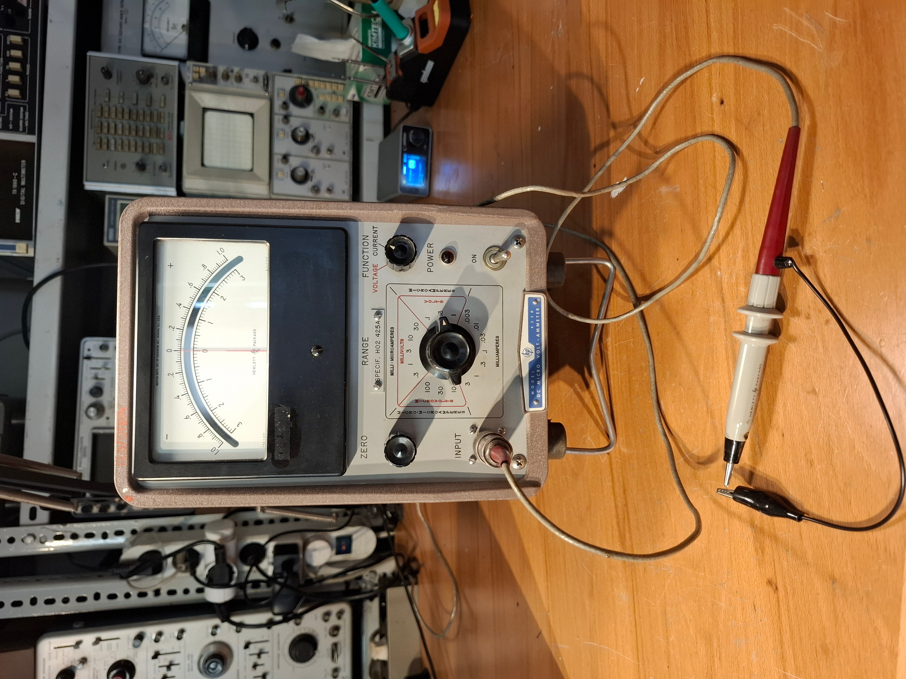
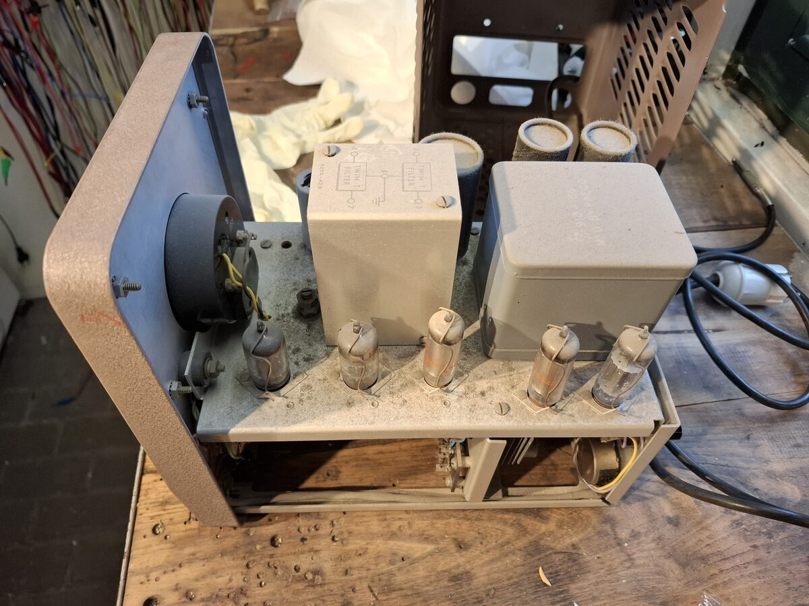
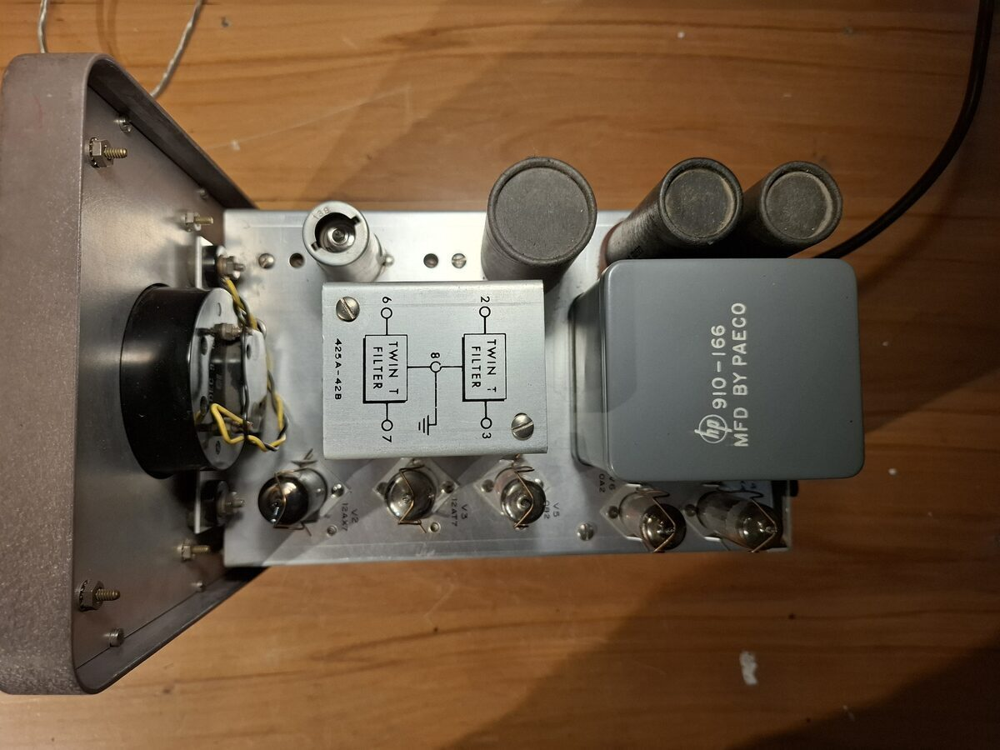
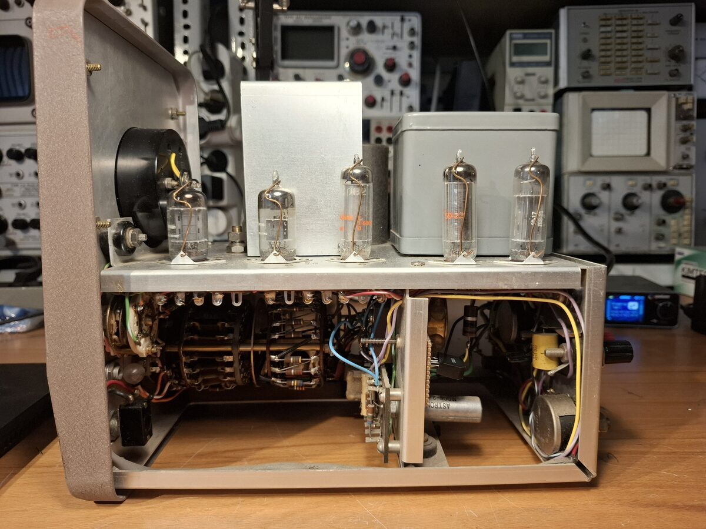
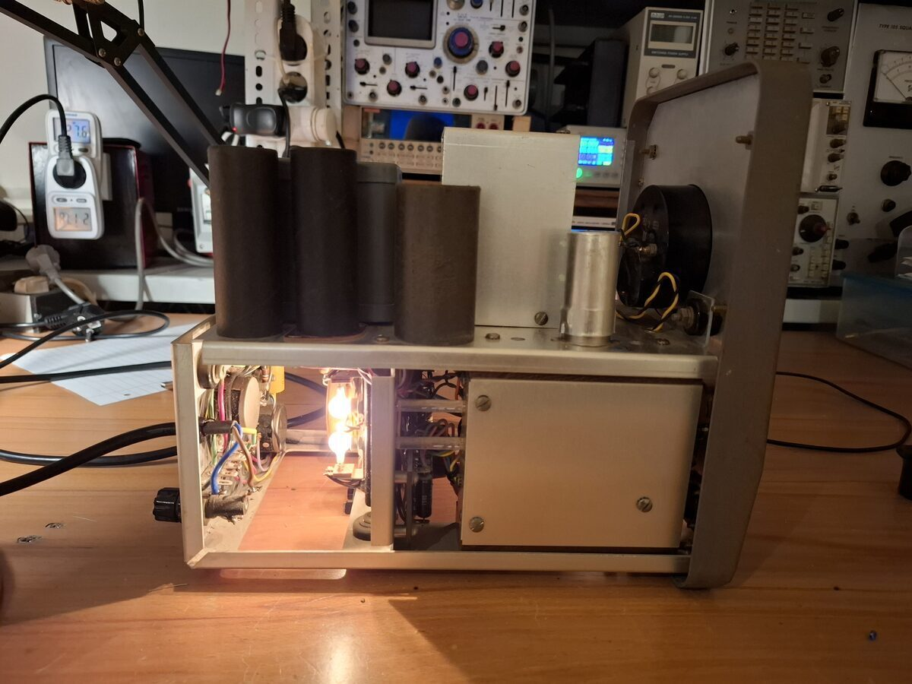
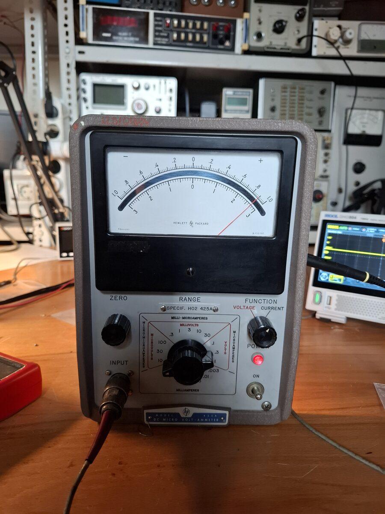

# HP 425A DC Micro Volt-Ammeter Restoration
**January 2026**

The HP 425A is a highly sensitive microvolt and picoamp meter released in 1958.

## Maintenance and Upgrades
Before powering the instrument for testing, minor maintenance was performed. The original selenium rectifier was replaced with a modern silicon rectifier bridge to ensure reliability. Additionally, the mains cable was replaced. The unit was thoroughly cleaned, and all tube sockets were treated with contact cleaner.

## Theory of Operation and Testing
The HP 425A utilizes a chopper amplifier to measure microvolts and picoamps across a shunt. The chopper mechanism employs a motor to mechanically interrupt light passing from incandescent bulbs, through a light guide, and onto photodetectors. This chopping frequency is deliberately set to 4/5 of the line frequency. Specific filters are then used to remove this chopping frequency from the final amplified signal.

The unit was successfully tested by measuring a 100G resistor. When 1V was applied, the scale accurately read approximately 10pA. The instrument's original low-triboelectric triaxial cable was used for these highly sensitive measurements.

