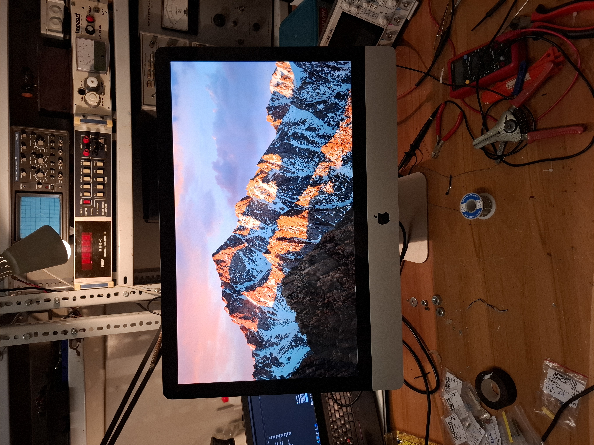
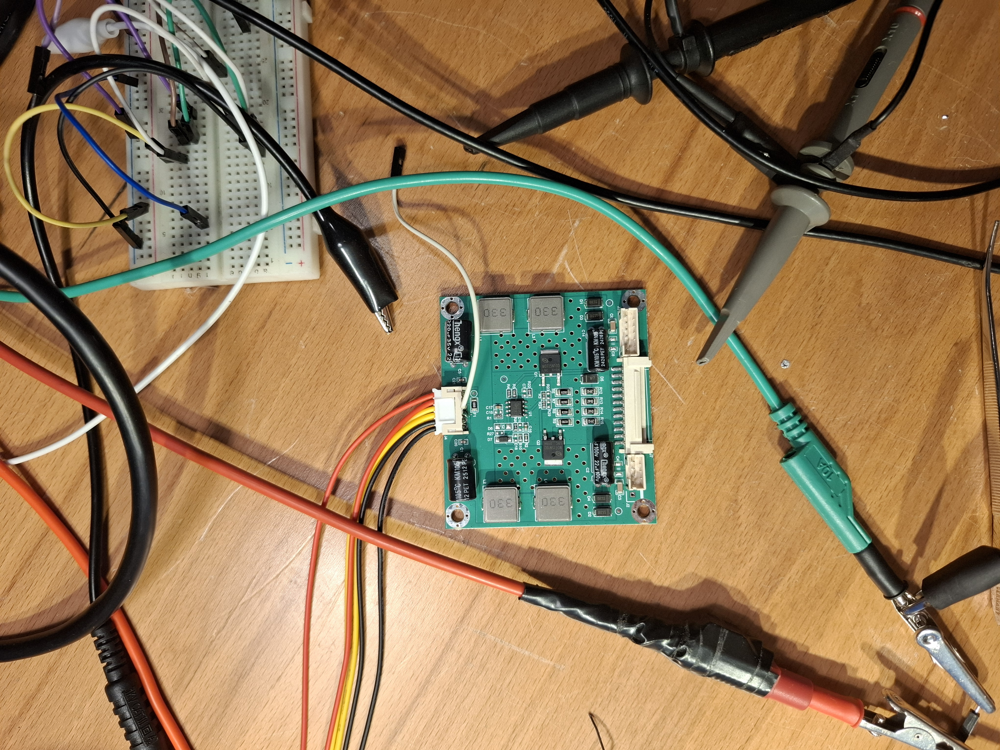
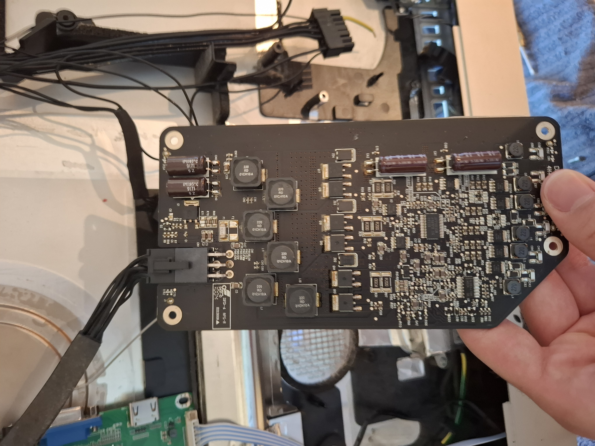
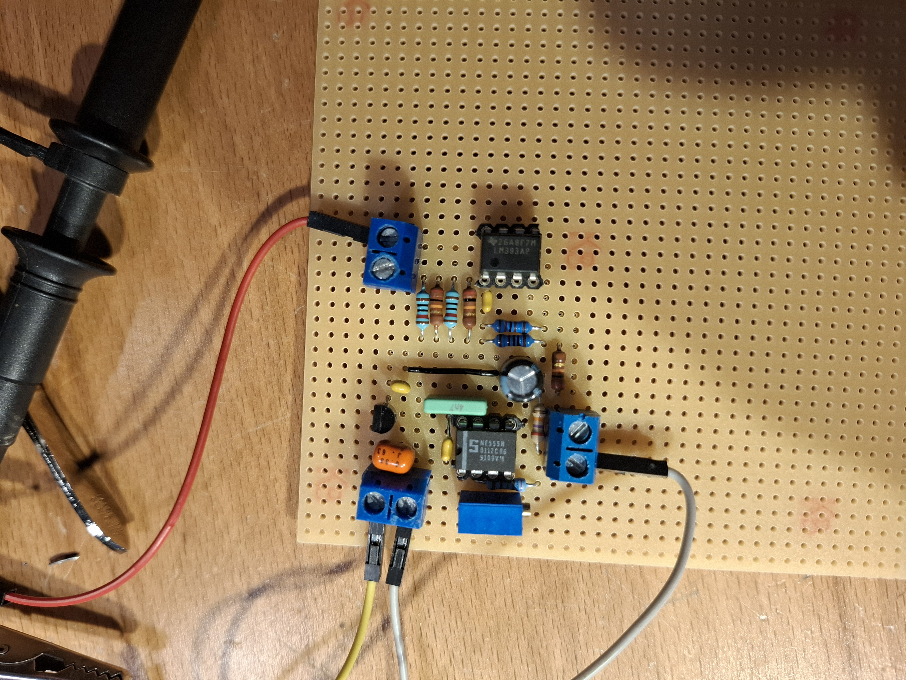
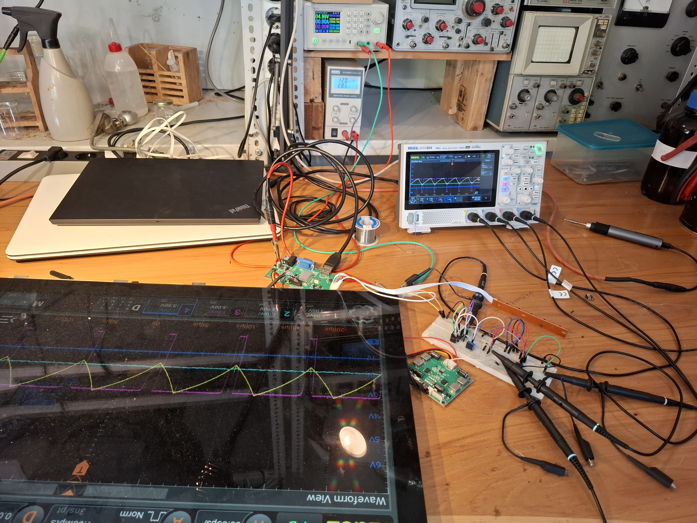
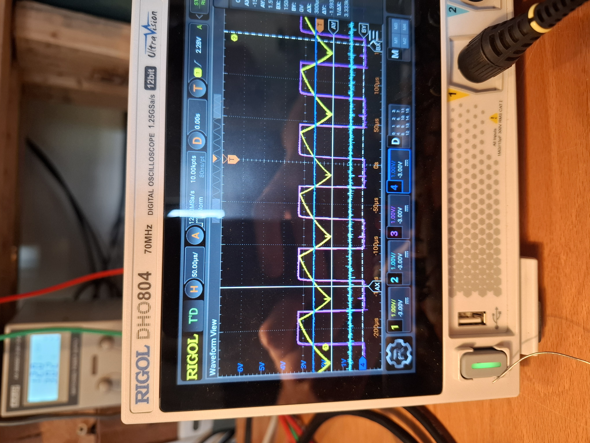

# 2010 27" Imac to monitor conversion
June 2025

A faulty 27" imac was converted to a monitor using the original power supply and inverter, and custom circuitry.

The display controller came with its own inverter, but the display was quite dim with it.

The original inverter looks much beefier, but needs a specific frequency PWM signal. Unfortunately, the new controller board outputs a DC signal to control brightness. Altough it is derived from a PWM signal on the PCB, it is the wrong frequency.

Therefore, a custom circuit was designed and assembled to convert the DC signal from the controller to a PWM signal for the original inverter. It consists of a 555 oscillator at the needed frequency, and a comparator that compares the triangle-like output of the 555 to the DC from the controller. The result is a PWM sigal.

With the high power consumption of the large display, the standby output of the original PSU was not enough. A latching circuit was used to turn the high current supply on and off from the power switch on the chassis.

The original speakers were used. The controls of the display driver were mounted on the RAM tray cover.