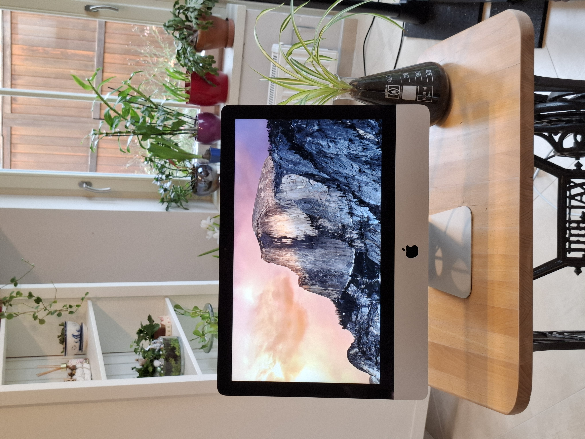
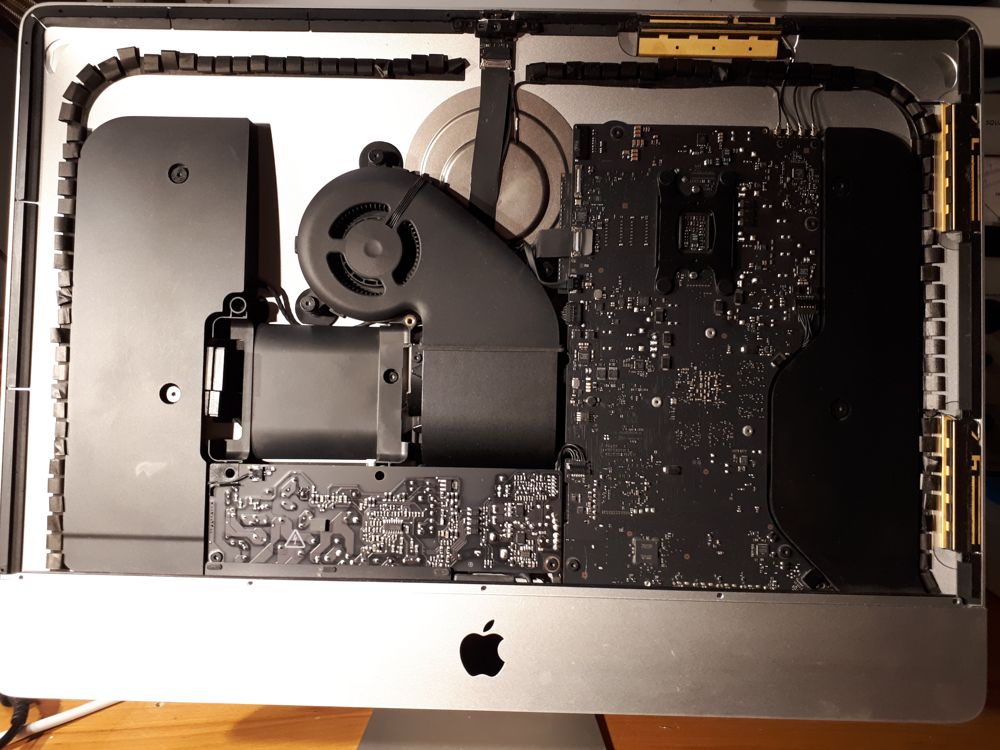
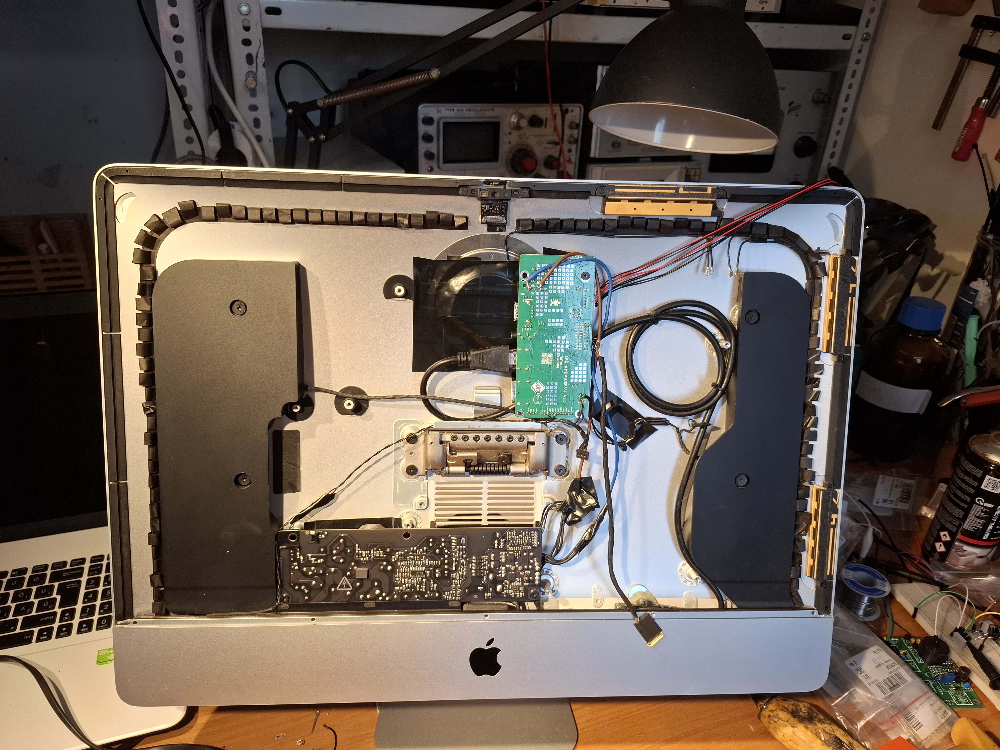

# 2013 Imac to monitor conversion
February 2025

An imac with a faulty motherboard was converted into a 1080p HDMI display.

Most of the insides were removed, except for the power supply and speakers. A display controller was sourced, and the display and speakers were hooked up to it. Power draw is low enough to use only the standby power supply. A female HDMI connector was fixed behind a USB port on the chassis.

