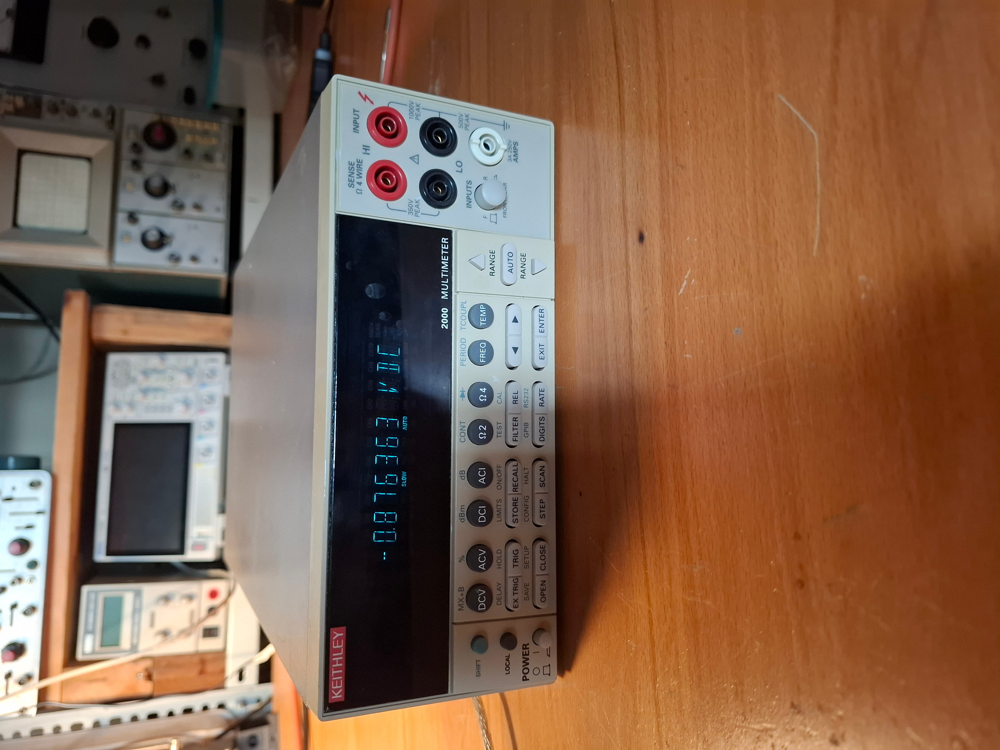
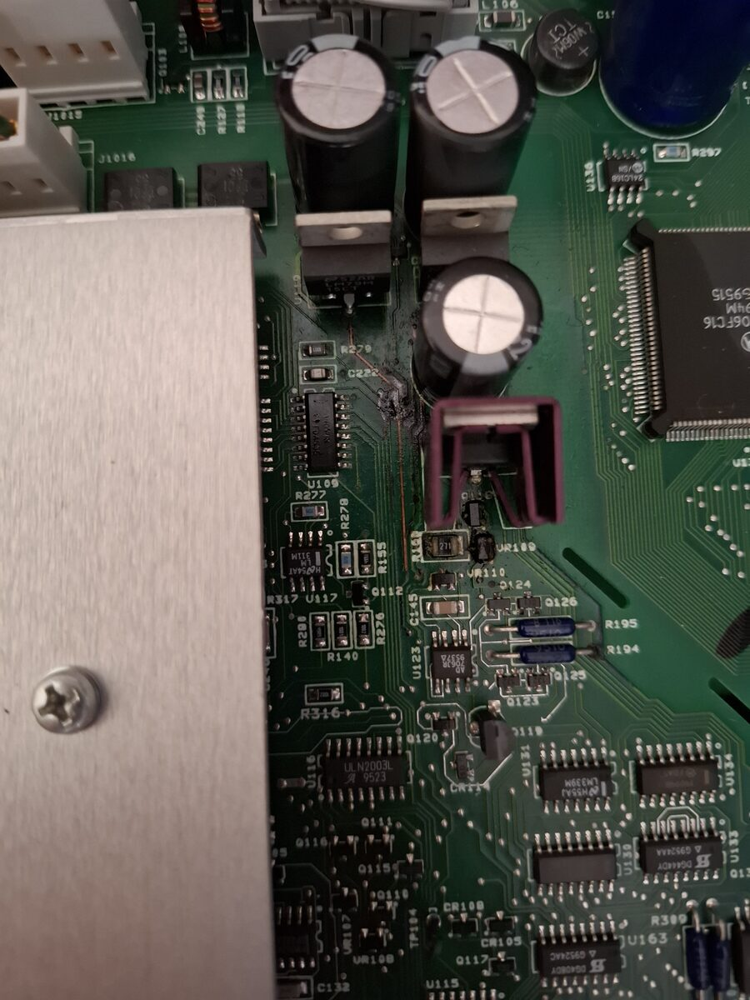
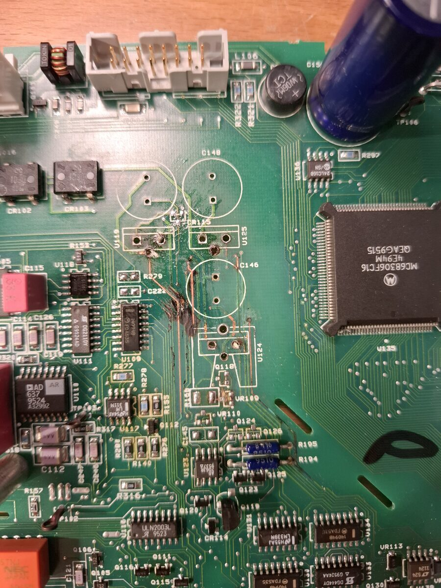
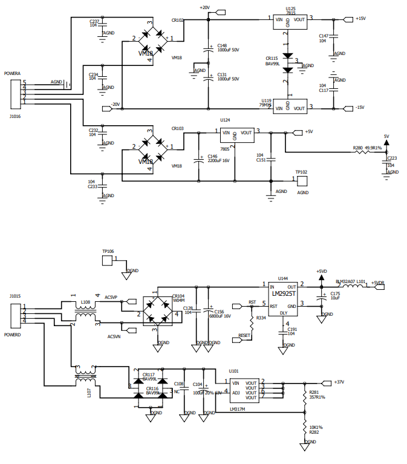
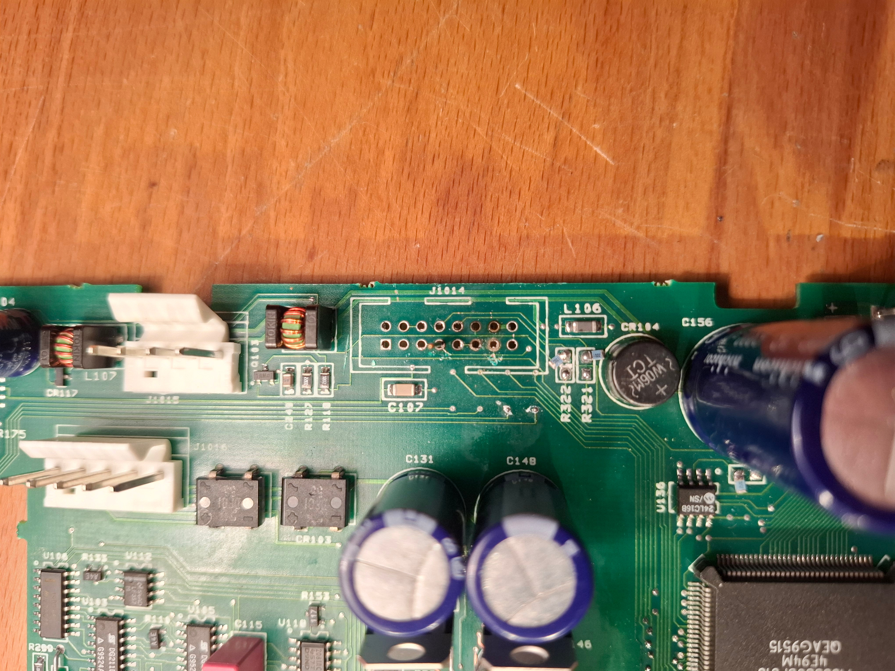
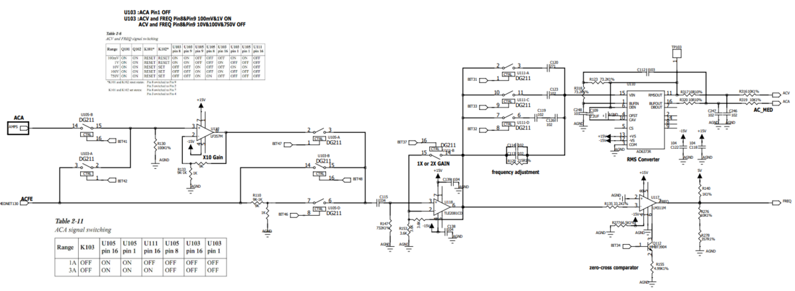
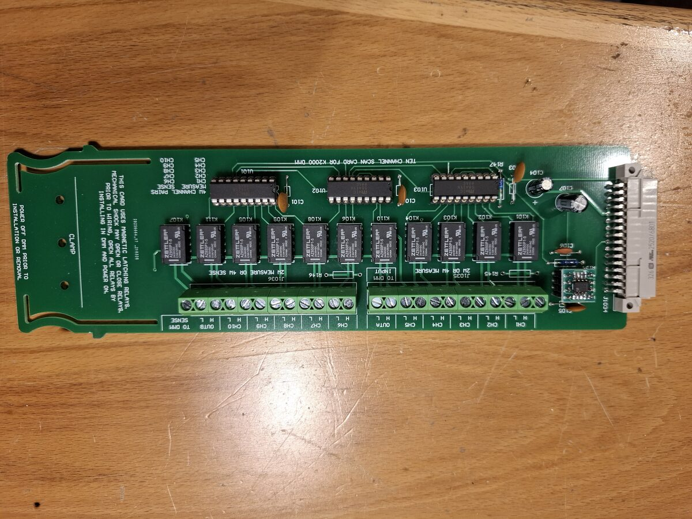

# Keithley 2000 6.5-Digit DMM Repair
**July 2025**

## Initial Condition and Power Supply Repair
The instrument arrived physically intact but completely unresponsive to power. Internal inspection revealed severe corrosion across the power supply area.

To accurately assess the damage, all components in the affected area were removed. The filter electrolytic capacitors—specifically C146, which is sandwiched between the linear regulator heat sinks—had leaked electrolyte extensively. This leakage damaged PCB traces, vias, and component legs, and the corrosion spread to affect portions of the AC measurement circuitry and the Ohms source.

The PCB was thoroughly cleaned with isopropyl alcohol (IPA). Broken traces and vias were repaired using hookup wire, and replacement components were installed. Following this repair, the analog power supply's +5V, +15V, and -15V rails operated normally; however, the unit still exhibited no display activity and failed to emit a boot beep.

## Restoring the Reset Line
Diagnostics showed that the reset line was preventing MCU boot. Instead of dropping low on boot and staying high, the line carried the positive half of a 50Hz sine wave. This specific 50Hz signal ("AC5VP") originates from the secondary winding of the digital 5V supply transformer. 

According to the schematics, the reset line and AC5VP only intersect physically at the display connector. After ruling out upstream interference, the connector was desoldered, exposing electrolyte corrosion trapped beneath it that was bridging the two lines. 

The area was cleaned with IPA and the connector was resoldered. The reset line returned to normal operation, allowing the MCU to boot and readings to populate on the VFD.

## Resolving Self-Test Errors and ACV Offset
Initially, the instrument threw a multitude of self-test errors across all test banks, spanning from the ADC to the AMP/OHM sections. Most of these errors were resolved by identifying and correcting missing power rails to various components.

The final persistent error was a 20% offset across all ACV ranges. Because the offset was universal across ranges, the signal path was traced backward from the RMS converter. The offset vanished just before the C115 330n decoupling capacitor. While the capacitor and the subsequent U118 op-amp (TLE2081) were initially suspected, the actual fault was the U117 zero-cross comparator (LM311). It was leaking current out of its inverting input, which introduced the offset to the AC reading.

## Custom Scanner Card
To expand the unit's capabilities, a 10-channel scanner card was fabricated based on a design published by voltsandjolts.

