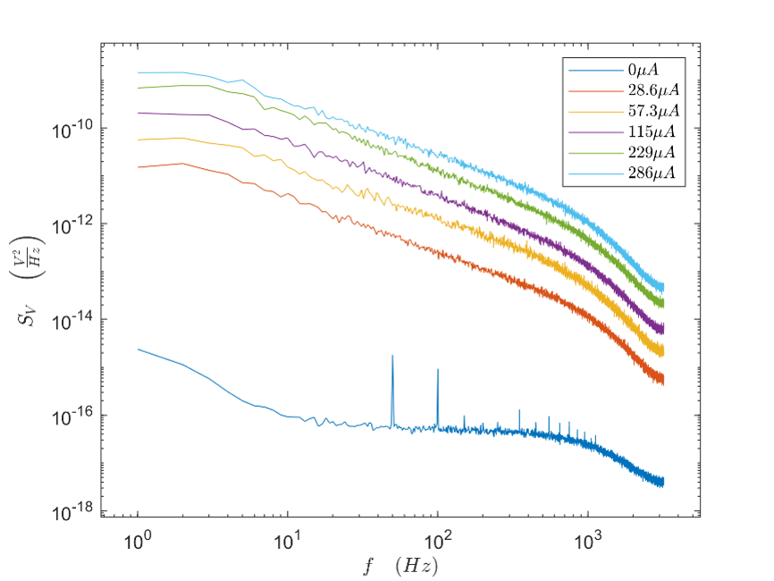
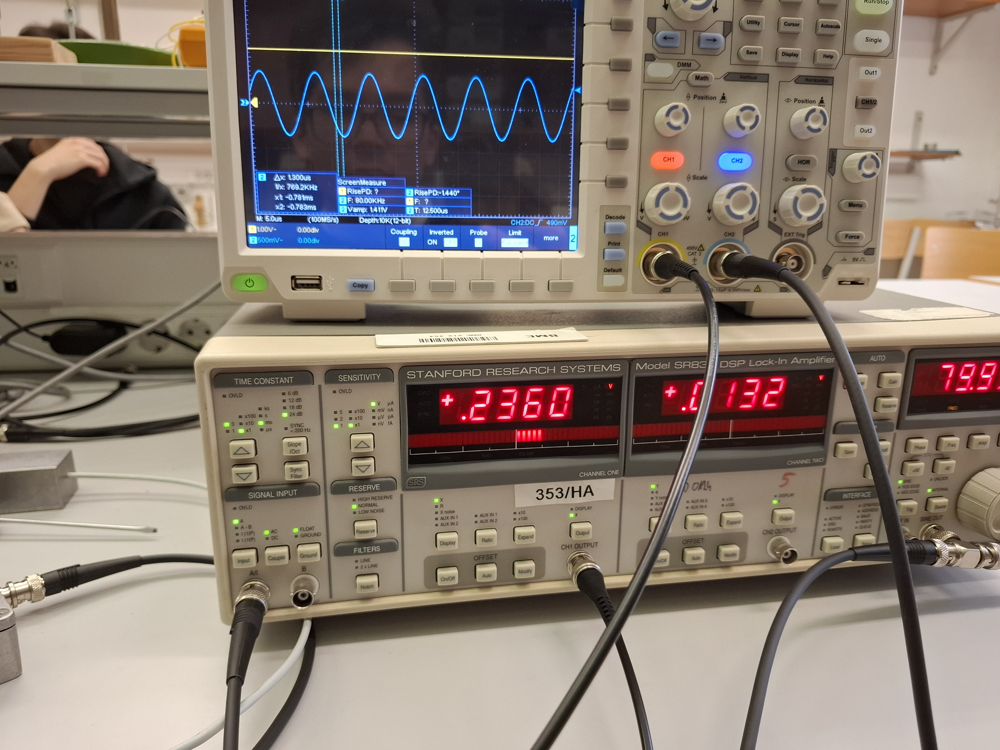
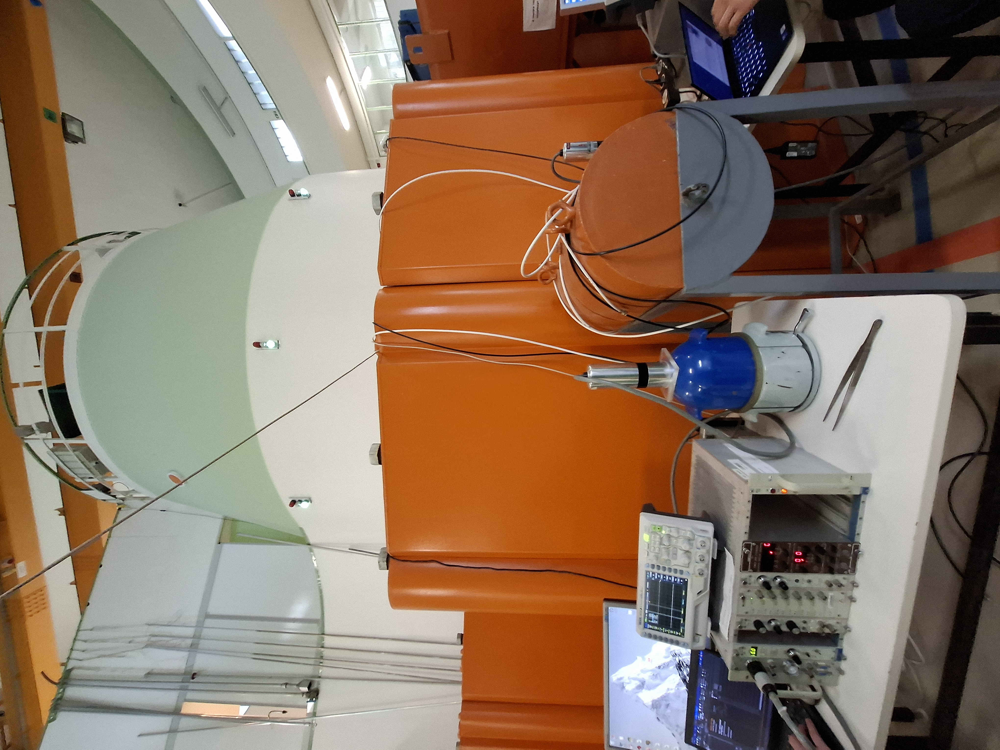
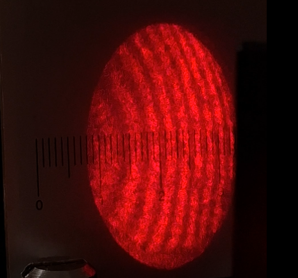
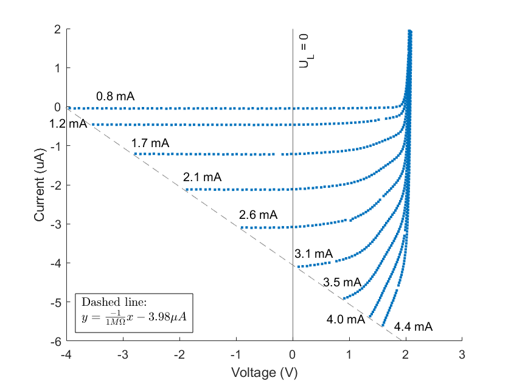
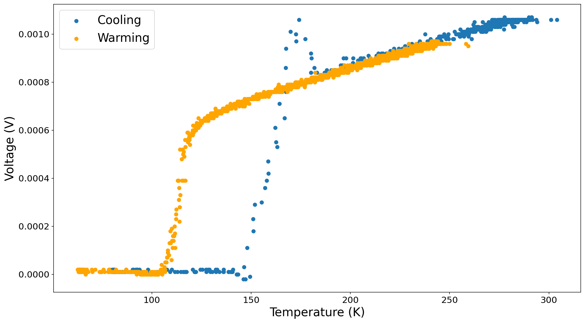
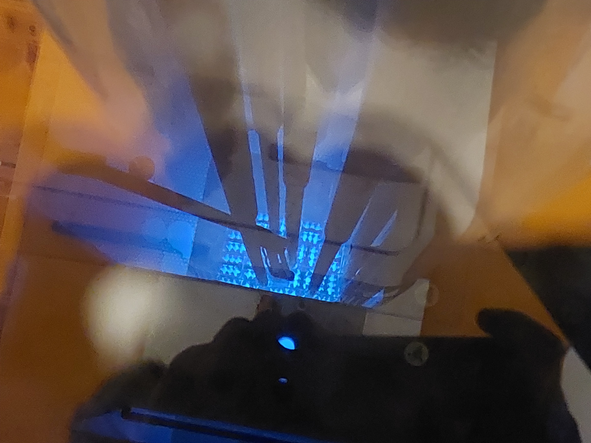

# Laboratory classes at BME

## Measurement techniques laboratory (4th semester, 5 credits)

* Spectral noise density measurements of thermal noise, shot noise and 1/f noise using a Low Noise Amplifier (LNA) and Dynamic Signal Analyzer (DSA)

* Lock-in amplifiers and Microelectromechanical systems (MEMS)

* Gamma spectrometry, neutron detection and deadtime measurements using the Training Reactor

* Atomic Force Microscopy (AFM)

* Heterodyne laser rangefinder

Total average result of lab reports: 96%.

## Computer controlled measurements (4th semester, 3 credits)

* NI MyDAQ curve tracer with GUI
* NI MyDAQ photodiode chopper amplifier with GUI
* Computer-controlled digital storage oscilloscope
* Basic C#-coded GUI programs using the NI MyDAQ

## Measurement design and laboratory excercises (3rd semester, 3 credits)

* Wave phenomena in transmission lines: measurement of coaxial cable capacitance, propagation velocity, reflections
* Michelson interferometry, Fourier transform spectrometer

* Photoelectric effect in photocell, LEDs

Average of lab reports: 98%

## Data collection and evaluation (2nd semester, 7 credits)

* Peltier and Seebeck effects
* Mechanical resonance
* Calorimetry
* Ultrasound measurements
* RC circuits
* LED characteristics

Average of lab reports: 96%

## Applications of Nobel prized technologies (1st semester, 3 credits)

* Superconductivity

* Training Reactor

* Holography
* Atomic nanowires
* Photoelectric effect

Report about superconductivity: excellent.