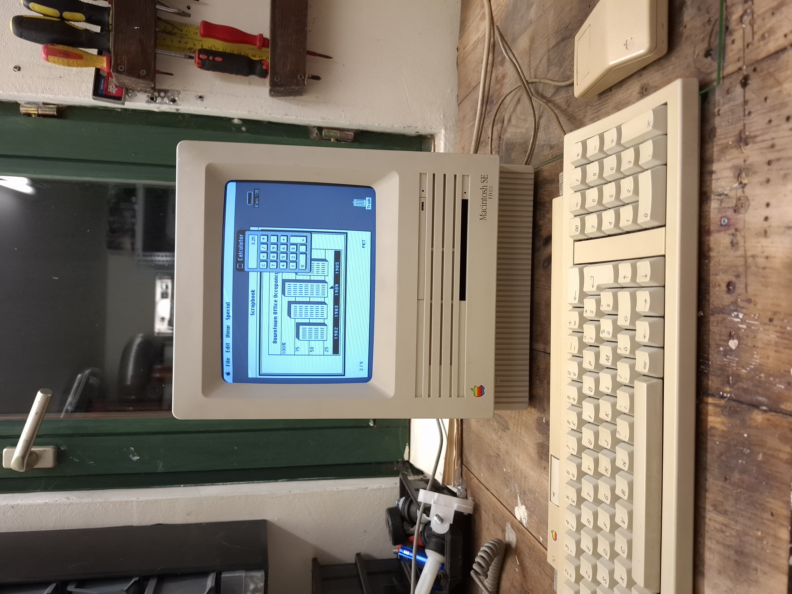
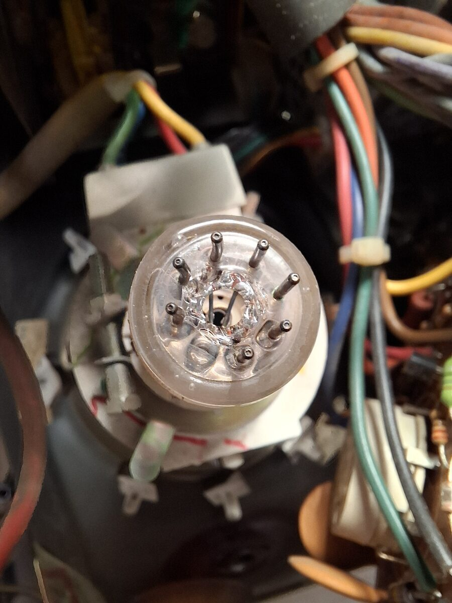
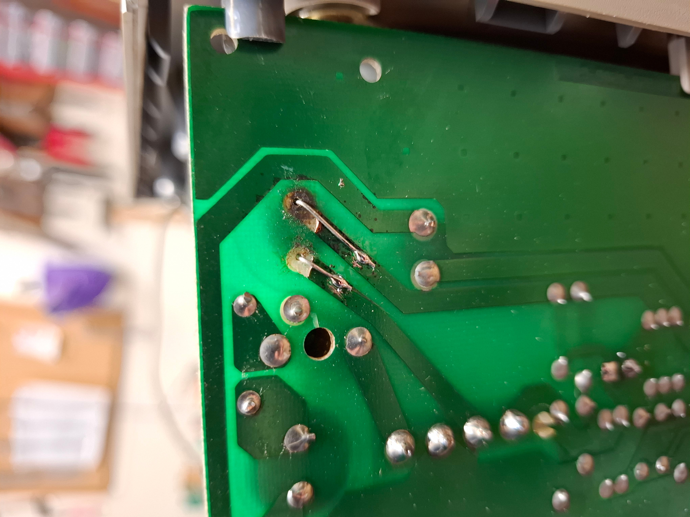
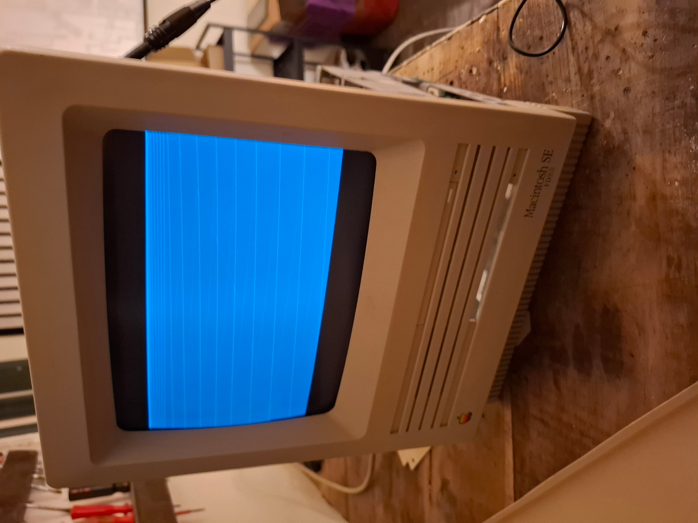
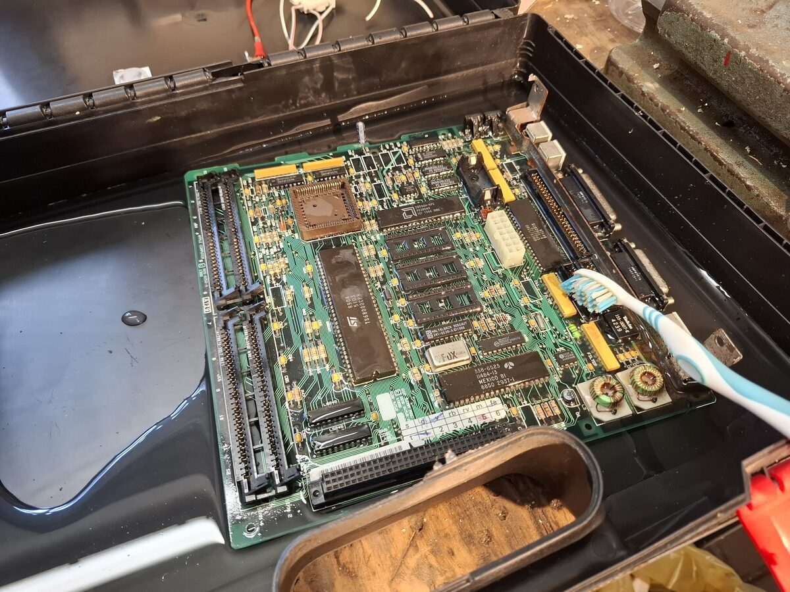
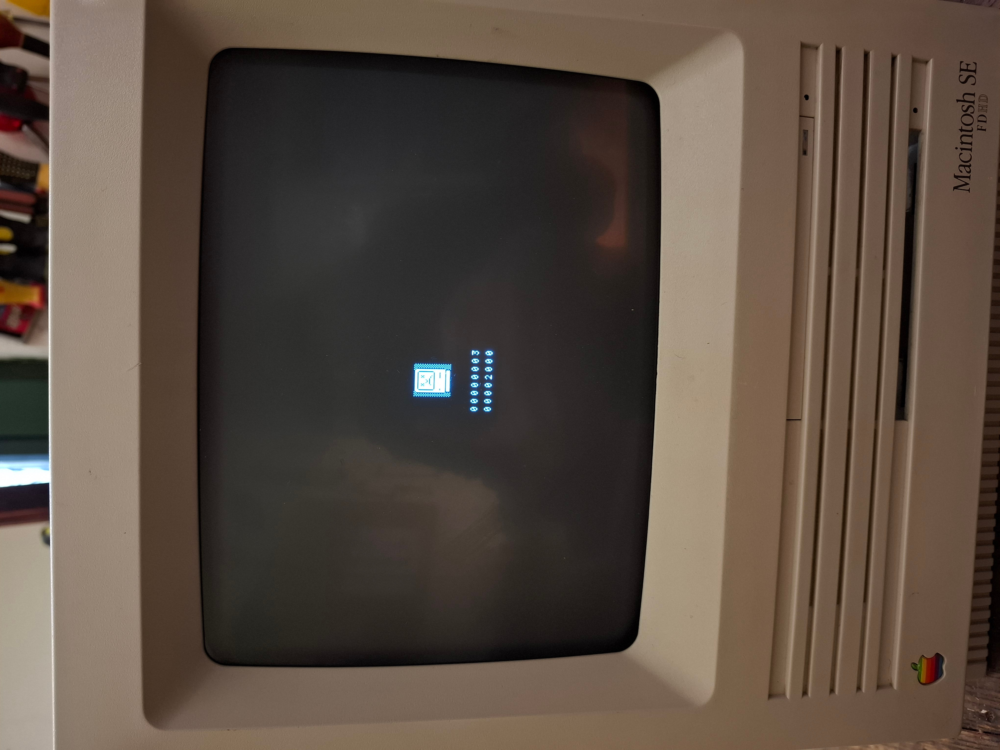
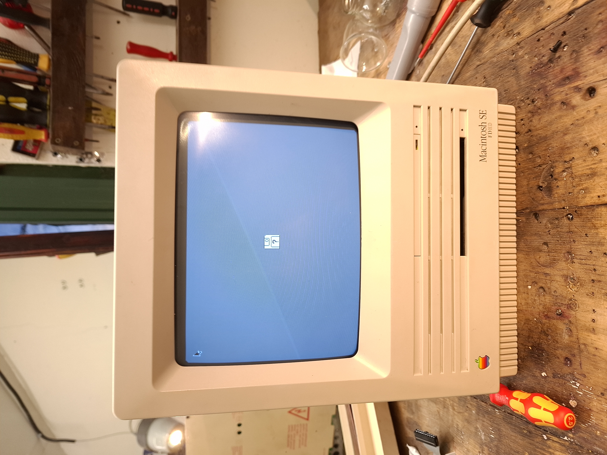

# Macintosh SE FDHD Repair
**February 2026**

## Initial Diagnostics and CRT Replacement
Upon initial testing, the fan spun, but there was no startup chime, display output, or drive activity. The 5V and 12V power rails were verified as present at the floppy connector. During disassembly, it was discovered that the CRT glass was shattered at the neckboard. A replacement CRT was sourced and installed.

## Analog Board Repair
Even with the new CRT, there was no display activity and the high voltage was missing. Inspection of the analog board revealed corrosion on the pad of C9 (1000uF 16V). The capacitor was found to be leaking and was replaced.

Following the capacitor replacement, the display powered on but showed only diagonal lines. After exploring multiple potential causes, it was determined that the logic board was not outputting a video signal. The diagonal lines were simply the result of an incorrect cutoff setting on the analog board.

## Logic (Digital) Board Restoration
The logic board suffered from significant corrosion originating around the axial electrolytic capacitors. All capacitors were desoldered, the bare board was cleaned thoroughly in IPA, and fresh capacitors were installed. The IC sockets were cleaned, and the PRAM battery was replaced.

The missing video signal was traced to cold solder joints around the video connector. Reflowing all joints on the connector restored the video signal, revealing a diagnostic screen. The on-screen error code indicated a memory fault.

Cleaning the RAM slots failed to resolve the error, but installing newly purchased memory successfully cleared the fault, allowing the system to boot to the flashing floppy icon with a functioning mouse cursor.

## Power Supply and Boot 
The power supply was proactively recapped, although testing showed all original capacitors were still within tolerance. With the hardware fully repaired and adjusted, a BlueSCSI emulator was used as a modern boot medium to successfully run System 6.0.8.