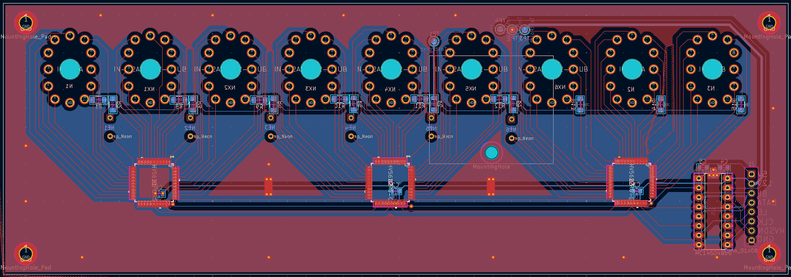
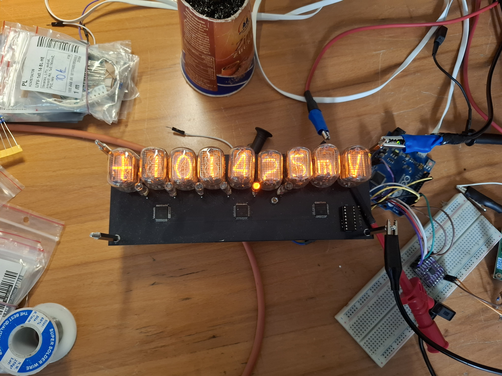

# Nixie tube DMM
2026 (in progress)

Aim: to develop a modern 5.5 digit benchtop DMM with nixie tube display.

## Progress
The nixie tube display board has been designed and manufactured. It has a IN-15A for the sign indicator, six IN12Bs for the digits, another IN15A for the prefix, and an IN15B for the unit, along with six INS-1 neon indicators for the decimal points. A total of 96 cathodes are controlled by three HV5622 high voltage shift registers. an MC14504 level translator fits the 12V logic level of the registers to a 5V input. An off-the-shelf HV power supply is bolted to the back.

An ADS1259 24bit ADC-based aquisition board was purchased and made to interface with an Arduino and the display. The desing of the analog front-end is in progress.