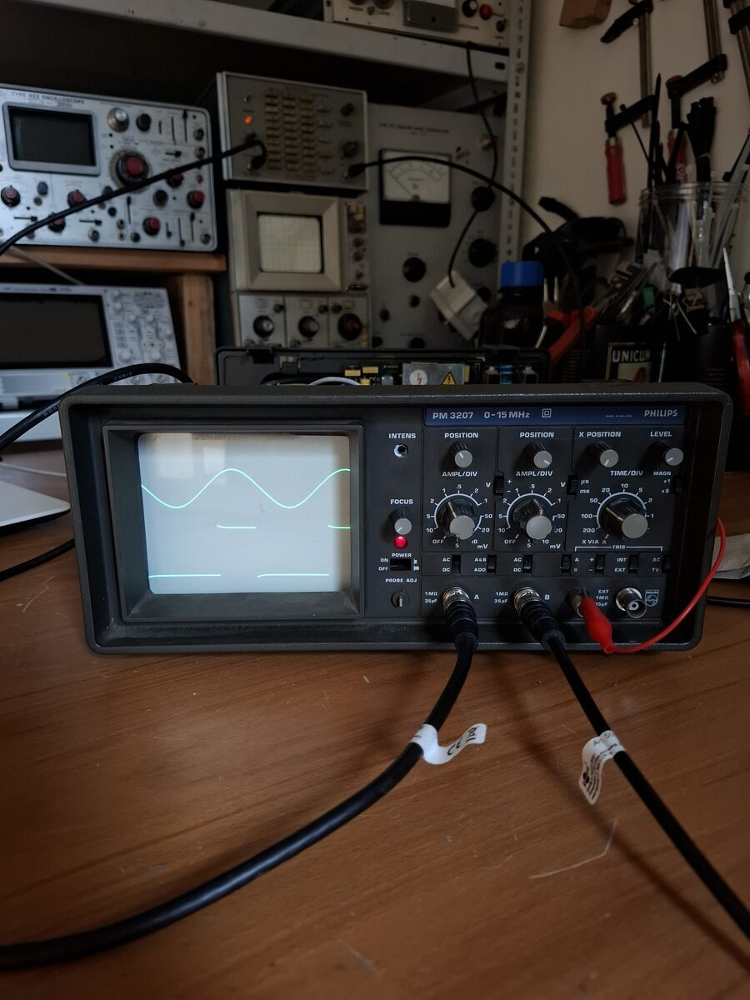
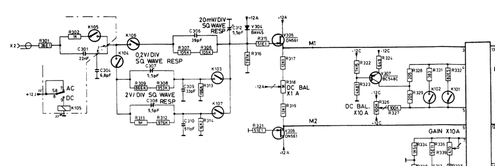
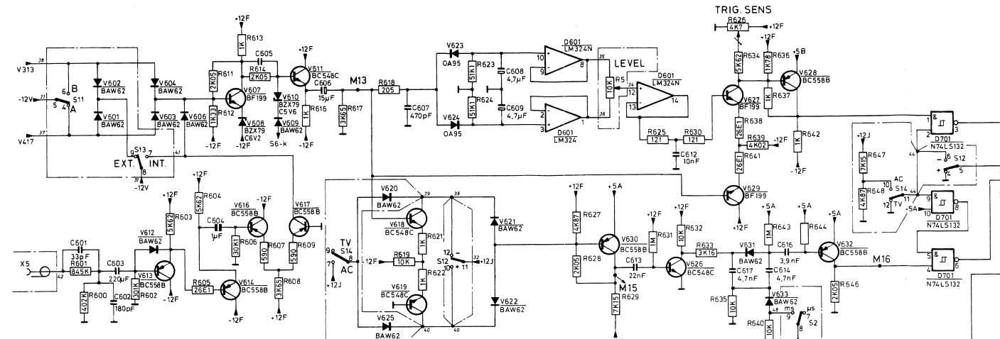

# Philips PM3207 Cathode Ray Oscilloscope Repair
**May 2025**

## Initial Condition
The oscilloscope presented several specific faults: Channel A was completely missing, the trigger was inoperative, and the Channel B vertical position potentiometer had no effect. Conversely, Channel B's signal path and the timebase sweep were functioning properly.

## Restoring Vertical Position Controls
The issue with the vertical position was mechanical: the pin headers connecting the main board to the control board contained bent and broken pins. Replacing these headers entirely restored normal vertical position control.

## Channel A Repair
To diagnose Channel A, a test signal was injected into the input. The signal successfully passed through the input attenuation stage but abnormally transformed into a large negative voltage immediately after passing through large-value resistors preceding the preamplifier. 

The fault was isolated to diode V304 (BAY45), which had failed and was incorrectly conducting the -12V supply directly into the signal path and through to the preamplifier. 

## Trigger Circuitry Repair
Investigation of the trigger circuitry showed that the trigger pick-off correctly fed the level detector, but the resulting signal never reached the comparator. The point of failure was D601 (an LM324 op-amp), which is responsible for amplifying the level signal and feeding it to the comparator. Replacing D601 restored full trigger functionality.

