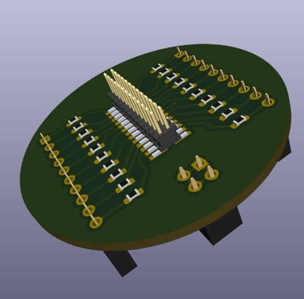
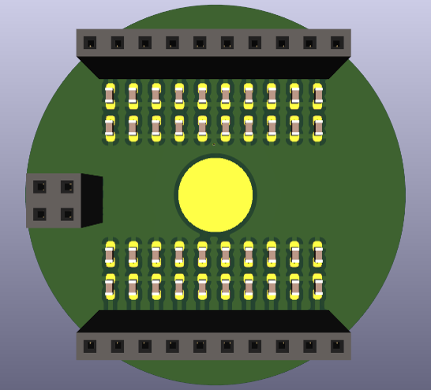
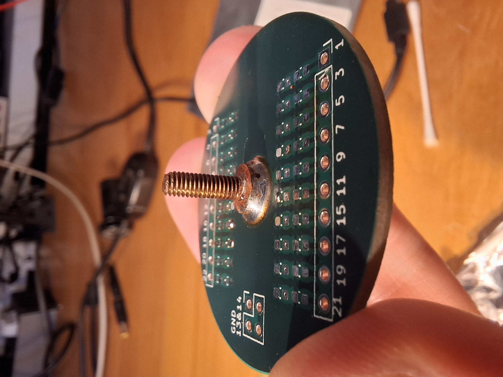
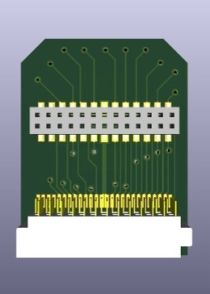
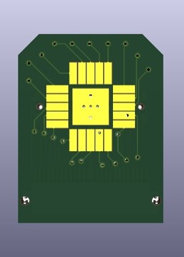
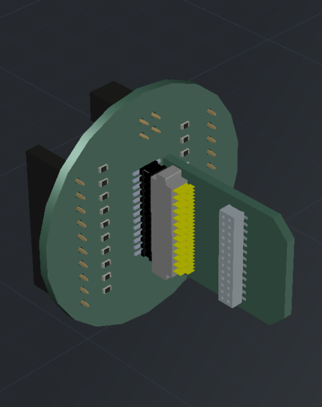
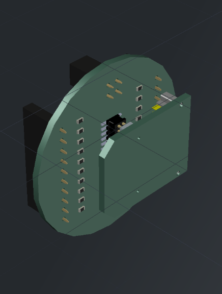

# Sideprobe PCB for the Nanoelectronics Laboratory

The BME Nanoelectronics Laboratory researches the quantumelectronic devices in cryogenic 3He-4He dilution fridges at millikelvin temperatures and strong magnetic fields. The fridge has a solenoidal electromagnet, and the group's samples are loaded into the bore of which using probes. The samples are prepared using electronlitography. Previously, they were glued onto chip carriers, which were inserted into chip carrier sockets.

The new sample holder is a small daughterboard, onto which the sample is mounted. The sample can be bonded directly to the gold plated PCB contacts. The established connector system used in the other probes was Samtec's CLP line. The design consisted of a circular motherboard with two 0.1" connectors for the 24 lines coming from the probe and CRC pi filters on each, and a compatible Samtec connector.

The daughterboard had two female Samtec connectors: one for in-plane, one for out-of-plane mounting.

The motherboard was mounted onto a female thread on an existing threaded rod via a small copper screw

