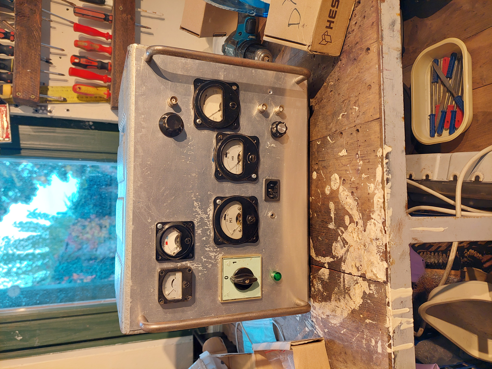
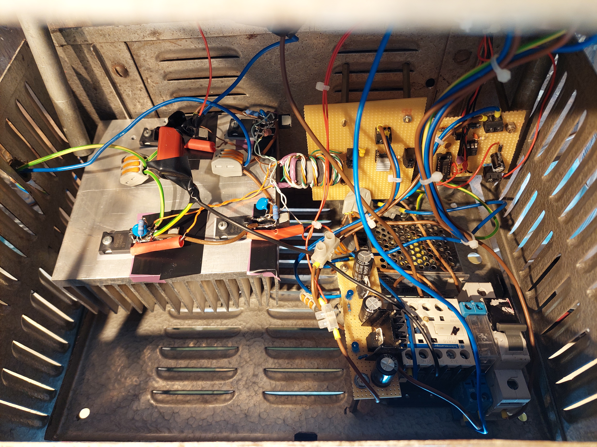

# Solid-State Tesla Coil
September 2022

A Tesla coil was designed and built using an IGBT H-bridge, mosfet driver and gate drive transformer, operated from rectified mains, with several hundred watts.

<video width="100%" controls>
  <source src="../images/sstc_arcs.mp4" type="video/mp4">
</video>

Left to right: power supplies, contactor, variable dutycycle interruptor, H-bridge driver, selected gate drive transformer, IGBT H-bridge.