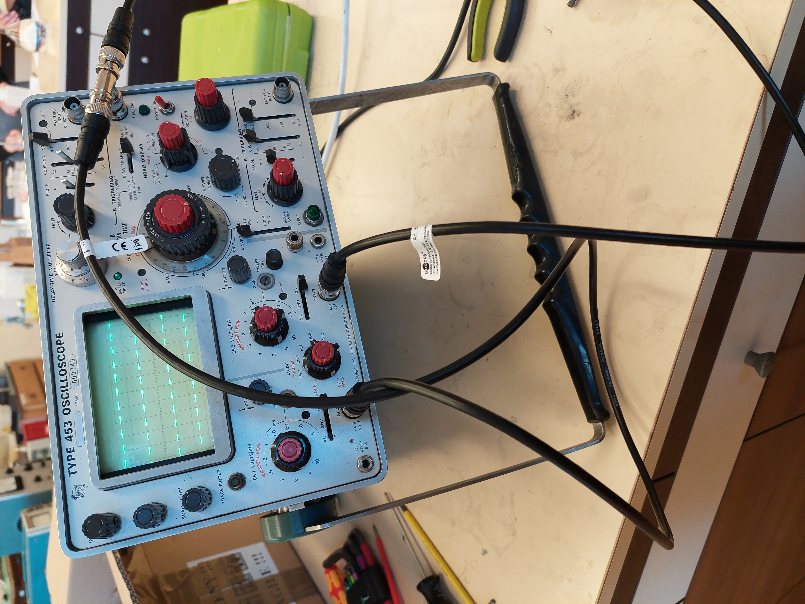
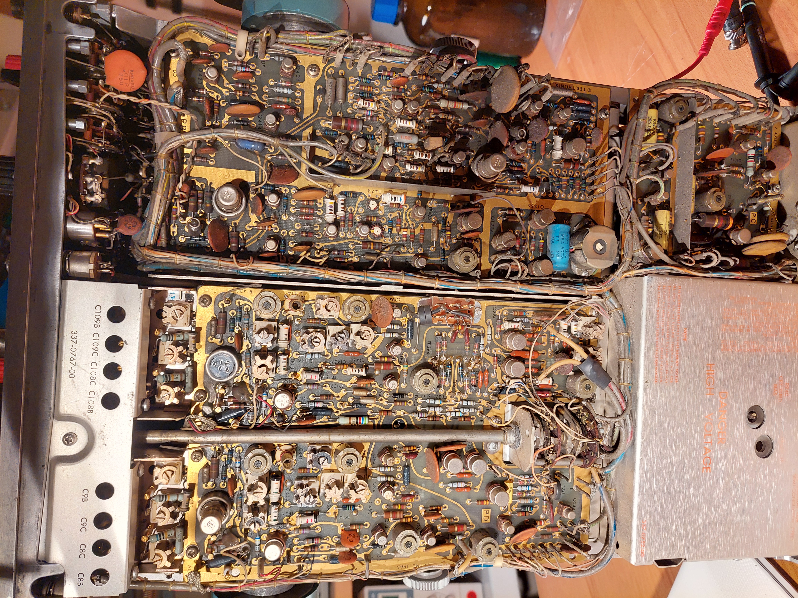
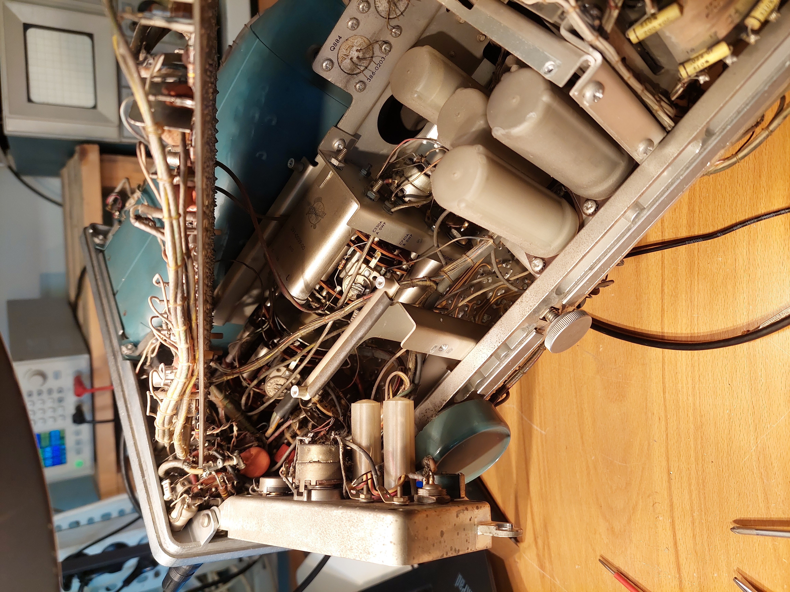

# Tektronix 453 oscilloscope repair
March 2022

The Tektronix 453 was a portable, (mostly) solid-state oscilloscope released in 1965. Its release price was approximately 20kUSD in 2026 dollars.

## Channel A repair

The unit arrived with channel B working, but no signal for channel A. The input signal was traced to a broken input resistor directly off the BNC connector.

## Delayed sweep

The B time base was not operational. A nuvistor was suspected in the B time-base. The nuvistor was swapped with one from the B vertical channel, and the delayed time base became operational. A new nuvistor was sourced, and used in the B time-base.

<video width="100%" controls>
  <source src="../images/453_Delayed.mp4" type="video/mp4">
</video>
