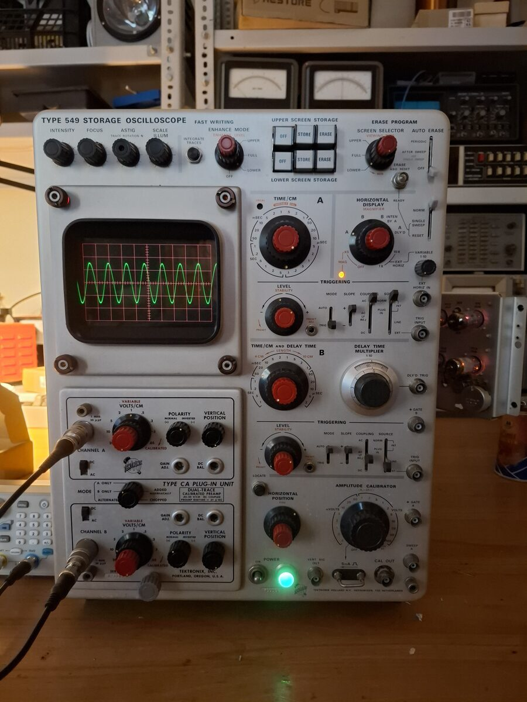
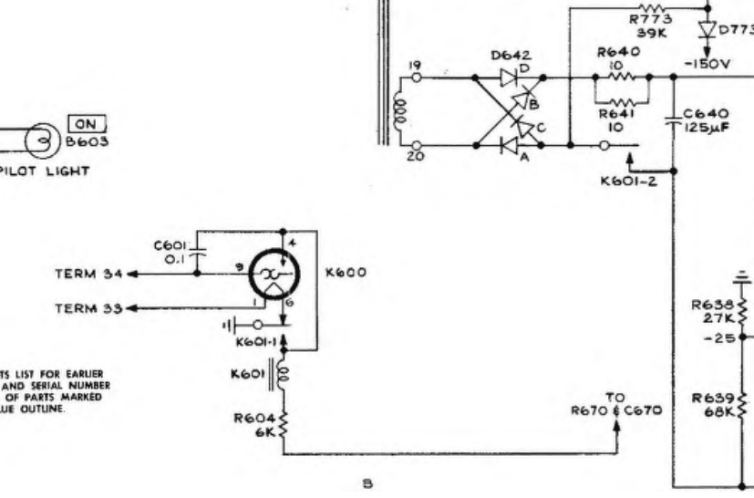
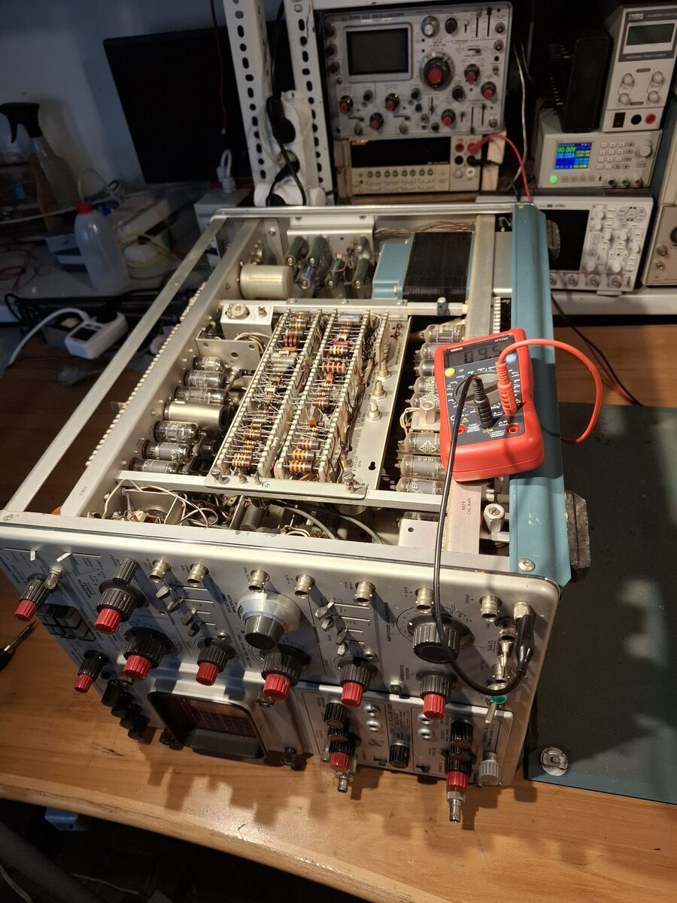
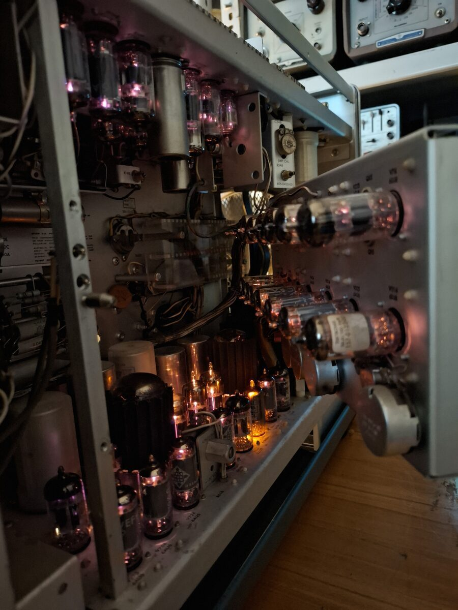
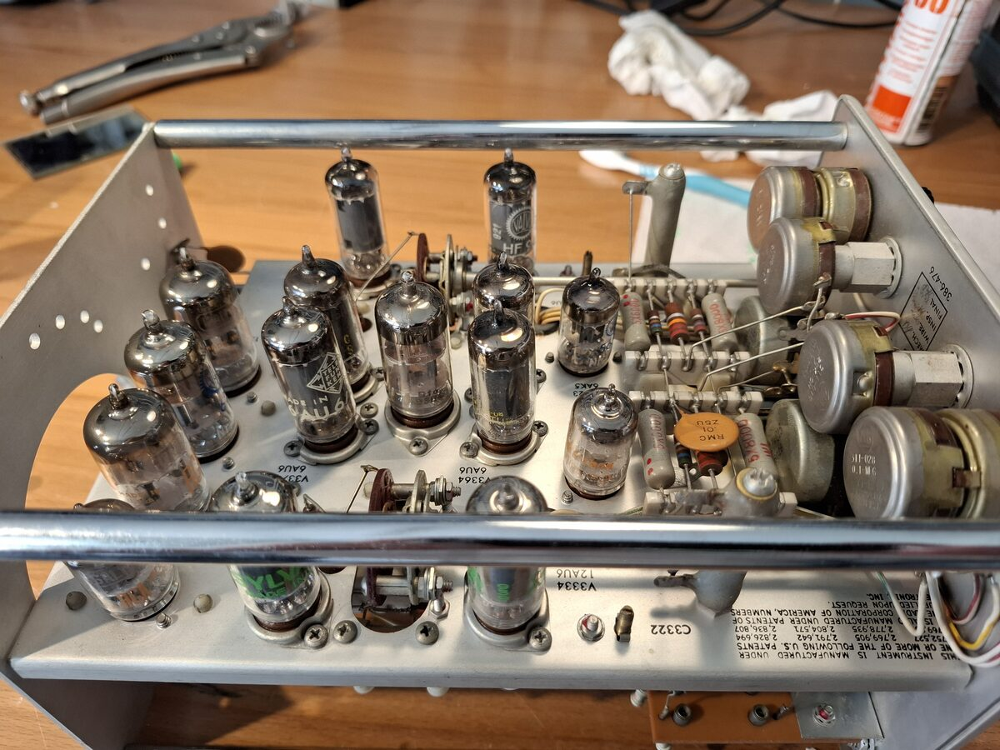
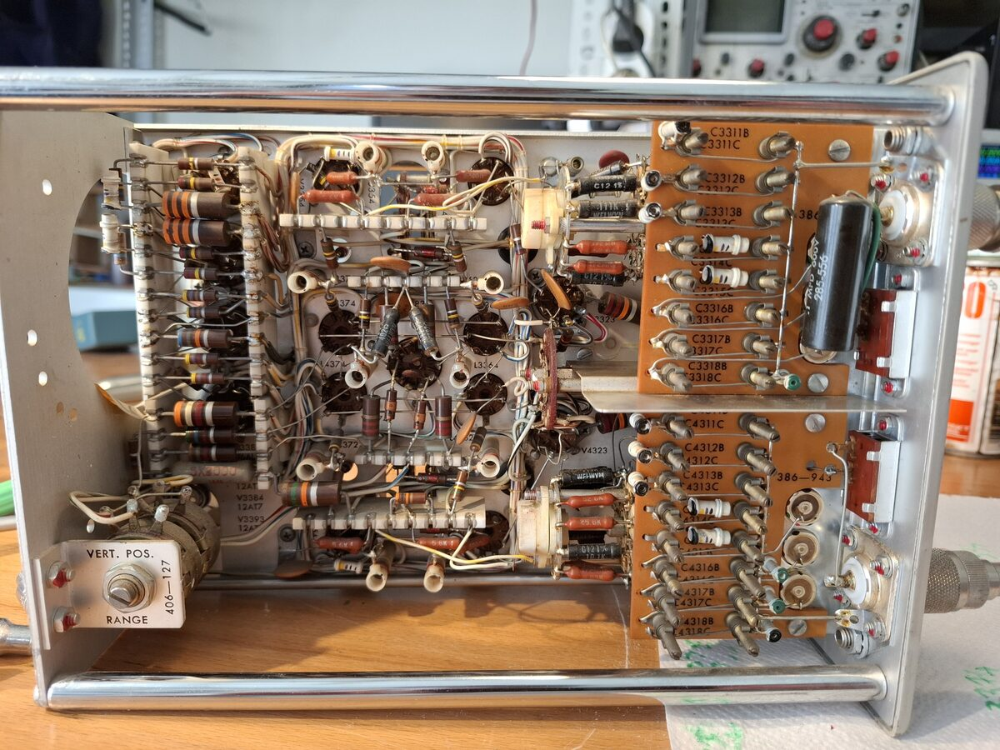

# Tektronix 549 Cathode Ray Oscilloscope Repair
**May 2026**

Released in 1965, the Tek 549 stands as one of the first analog storage oscilloscopes. It weighed 32kg and carried an inflation-adjusted price tag of approximately $20,000 USD in 2026. 

**Key Specifications:**
*   It operates with a bandwidth of 30MHz.
*   The system includes a delayed time base, as well as a voltage calibrator.
*   The CRT features two separately controllable storage zones.

## Diagnostics: Power Draw with No CRT Activity
The initial symptom was a complete lack of CRT activity, with only fan spin and power draw present. Because the oscilloscope contains approximately 60 vacuum tubes, heater power is supplied first to prevent damage. A bimetallic delay tube is used to turn on the main power supplies only after the tubes have sufficiently warmed up.

Terminals 33 and 34 connect to a 6.3V tap on the main transformer. Relay K601 is responsible for switching power to the plate voltage supplies. During power-up, contact K601-1 routes power to the heater of K600. After a 30-second delay, the bimetal switch closes, energizing the coil of K601. Relay K601-1 then removes power from the thermal delay tube while keeping K601 latched on. 

Investigation revealed that the thermal delay tube was not receiving heater power due to a dirty K601-1 contact. Cleaning this contact restored the delayed turn-on sequence.

## Cleaning and Final Assembly

The B sweep circuitry is mounted on a convenient fold-out panel located above the power supplies. 

This specific unit was equipped with a Type CA dual-channel vertical plug-in.

